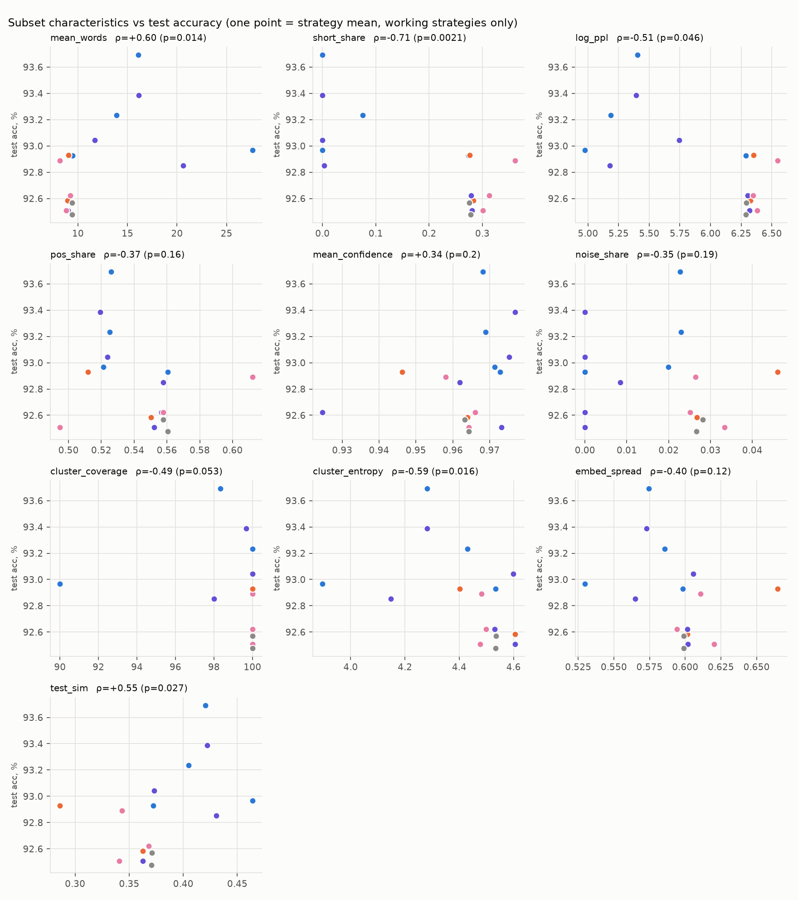
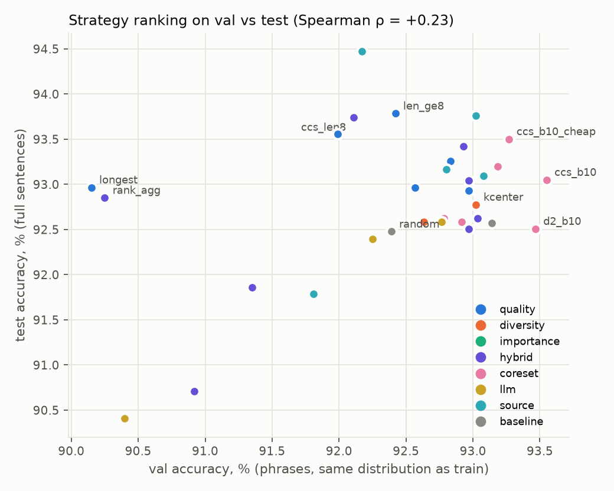

# Отбор 10% данных SST-2 для дообучения ModernBERT

**Вопрос.** Как выбор подмножества влияет на качество ModernBERT-base, обученного на 10% GLUE SST-2?
Какие критерии отбора — качество, разнообразие, важность — работают, где прокси-метрики расходятся
с реальным качеством, и как улучшить существующие методы.

**Коротко.**
- Лучший отбор оказался самым простым: случайные фразы длиной ≥ 8 слов. **+1.3 п.п.** к random
  (0.938 против 0.925, p = 0.003); закрывает **65%** разрыва до обучения на всех данных (0.945).
- Ручной порог можно заменить автоматическим: **доменный классификатор** (эмбеддинги, неразмеченные
  целевые предложения) сам выучивает «длину» и даёт **+1.1 п.п.** (p = 0.005), статистически
  неотличимо от ручного фильтра. Лексический метод DSIR этот сдвиг не видит.
- Отбор по «важности» в чистом виде (hard / ambiguous из Dataset Cartography) **катастрофичен**:
  точность падает до уровня монетки. 10% «самых трудных» примеров SST-2 — это на 22% ошибки разметки.
- Методы из литературы (CCS, D² Pruning) **значимо лучше random на валидации из того же распределения,
  что train, но не на тесте** — у SST-2 train (фрагменты фраз) и test (целые предложения) различаются.
  Ранги стратегий на val и test не коррелируют (ρ = −0.04).
- Дорогие скоры трудности можно заменить дешёвыми (1 эпоха на 10% данных, ≈ 9× меньше вычислений)
  без потери качества отбора.
- Проверка на бюджетах 1–20%: доменный отбор лучше random на всех бюджетах, а на 20% **сравнивается
  с обучением на всех данных** (0.946 против 0.945). CCS выигрывает только около 10%, а на 1%
  проваливается (−9 п.п.): при малом бюджете трудные примеры вредят.

---

## 1. Постановка

| | |
|---|---|
| Модель | `answerdotai/ModernBERT-base` (149M), классификация, bf16 |
| Датасет | GLUE SST-2 (бинарная тональность) |
| Бюджет | 10% пула = **6 534** примера |
| Гиперпараметры | одинаковые для всех стратегий: lr 5e-5, batch 32, 3 эпохи, warmup 6%, wd 0.01, max_len 64 |
| Метрики | accuracy и F1 на test; эпоха выбирается по val |
| Повторы | 3–5 сидов на стратегию (сид задаёт и подмножество, и обучение); обучение детерминировано — один и тот же сид даёт одинаковый результат до последнего знака |
| Значимость | Welch t-test против random (5 сидов) |

**Сплиты.** У SST-2 test закрыт, поэтому:

| сплит | источник | размер | доля позитивных |
|---|---|---|---|
| pool | GLUE train минус val, отсюда отбираем | 65 349 | 0.558 |
| val | стратифицированная часть GLUE train | 2 000 | 0.558 |
| test | GLUE validation | 872 | 0.509 |

**Сдвиг распределения — ключ ко всем результатам.** Train SST-2 состоит из поддеревьев разбора
предложений («a heartfelt story», «that both thrills the eye and»), test — из целых предложений.

| | pool / val | test |
|---|---|---|
| медиана длины | 7 слов | 19 слов |
| доля фраз ≤ 3 слов | 27.6% | 0.3% |

Отсюда два следствия: (1) подмножества, ближе похожие на целые предложения, должны лучше переноситься
на test; (2) val, вырезанный из train, плохо предсказывает test.

**Опорные точки.** Full data (100%): **0.9450**. Random 10%: **0.9248 ± 0.0048**. Весь возможный
выигрыш от отбора — около 2 п.п.; разброс между сидами — около 0.5 п.п.

## 2. Стратегии

Каждая стратегия возвращает 6 534 индекса пула. Все скоры посчитаны один раз и лежат в
`data/scores.parquet`.

| ось | стратегия | что делает |
|---|---|---|
| baseline | `random`, `stratified` | случайно; случайно с сохранением баланса классов |
| качество | `len_ge8` | случайные фразы ≥ 8 слов |
| | `longest` | самые длинные фразы |
| | `low_ppl` | случайные из нижней половины по perplexity GPT-2 |
| | `clean` | случайные после удаления подозрительных меток (cleanlab на out-of-fold вероятностях, 3-fold CV) |
| доменное соответствие | `domain_clf` | логистическая регрессия на эмбеддингах MiniLM отличает неразмеченные предложения GLUE SST-2 test (1 821, метки скрыты; это не наш test) от pool; отбор по log-odds с Gumbel top-k — как фильтр данных GPT-3 (Brown et al., 2020) |
| | `dsir` | **DSIR** (Xie et al., NeurIPS 2023): importance resampling по хэшированным uni+bigram к тем же целевым предложениям |
| разнообразие | `kmeans` | поровну из 100 кластеров эмбеддингов MiniLM |
| | `kcenter` | greedy k-center (coreset, Sener & Savarese 2018) |
| важность | `hard`, `easy`, `ambiguous` | top-k по Dataset Cartography (Swayamdipta et al. 2020): низкая / высокая confidence, высокая variability; `_bal` — то же с балансом классов |
| литература | `ccs_b03`, `ccs_b10` | **CCS** (Zheng et al., ICLR 2023): отбросить β% самых трудных по EL2N, остальное — равномерно по 50 стратам трудности |
| | `moderate` | **Moderate Coreset** (Xia et al., ICLR 2023): расстояние до центра класса ближе всего к медиане |
| | `d2`, `d2_b10` | **D² Pruning** (Maharana et al., ICLR 2024): message passing трудности по kNN-графу, жадный выбор с подавлением соседей; `_b10` — с отсечением 10% трудных |
| гибриды | `clean_len8`, `clean_len5_kmeans`, `clean_kmeans`, `clean_ambiguous_bal`, `mix_ambig20`, `rank_agg`, `ccs_len8` | комбинации: чистка шума + фильтр длины + разнообразие / важность; `rank_agg` — средний перцентильный ранг длины, чистоты метки и variability |
| масштабируемость | `ccs_b10_cheap`, `ccs_len8_cheap` | те же CCS / гибрид, но на дешёвых скорах (раздел 6) |
| контроль баланса | `ccs_b10_bal`, `ccs_b10_cheap_bal` | CCS внутри каждого класса с долями классов pool |

## 3. Результаты


**Рабочие стратегии** (test acc > 0.9), отсортированы по test:

| стратегия | ось | сидов | test acc | test F1 | Δ к random, п.п. | закрыто разрыва | p (test) | val acc | p (val) |
|---|---|---|---|---|---|---|---|---|---|
| full 100% | — | 1 | 0.9450 | 0.9467 | +2.02 | 100% | — | 0.9545 | — |
| **len_ge8** | качество | 5 | **0.9378 ± 0.0015** | 0.9392 | **+1.31** | **65%** | **0.003** | 0.9242 | 0.87 |
| ccs_len8 | гибрид | 5 | 0.9374 ± 0.0039 | 0.9379 | +1.26 | 63% | 0.002 | 0.9211 | 0.49 |
| **domain_clf** | домен | 5 | **0.9356 ± 0.0034** | 0.9368 | **+1.08** | **53%** | **0.005** | 0.9199 | 0.16 |
| ccs_b10_cheap | литература | 3 | 0.9350 ± 0.0007 | 0.9359 | +1.02 | 51% | 0.008 | 0.9327 | 0.03 |
| clean_len8 | гибрид | 5 | 0.9342 ± 0.0028 | 0.9357 | +0.94 | 47% | 0.008 | 0.9293 | 0.03 |
| low_ppl | качество | 5 | 0.9326 ± 0.0031 | 0.9334 | +0.78 | 39% | 0.02 | 0.9283 | 0.04 |
| ccs_b10_cheap_bal | литература | 3 | 0.9320 ± 0.0029 | 0.9331 | +0.72 | 36% | 0.04 | 0.9318 | 0.06 |
| ccs_b10 | литература | 5 | 0.9305 ± 0.0065 | 0.9323 | +0.57 | 28% | 0.16 | **0.9355** | **0.0008** |
| clean_len5_kmeans | гибрид | 3 | 0.9304 ± 0.0052 | 0.9313 | +0.57 | 28% | 0.20 | 0.9297 | 0.20 |
| longest | качество | 3 | 0.9297 ± 0.0065 | 0.9301 | +0.49 | 24% | 0.33 | 0.9015 | 0.002 ↓ |
| dsir | домен | 3 | 0.9297 ± 0.0059 | 0.9305 | +0.49 | 24% | 0.30 | 0.9257 | 0.49 |
| clean | качество | 3 | 0.9293 ± 0.0027 | 0.9305 | +0.45 | 22% | 0.14 | 0.9297 | 0.05 |
| rank_agg | гибрид | 3 | 0.9285 ± 0.0007 | 0.9294 | +0.37 | 19% | 0.16 | 0.9025 | <0.001 ↓ |
| kcenter | разнообразие | 5 | 0.9278 ± 0.0042 | 0.9296 | +0.30 | 15% | 0.33 | 0.9302 | 0.04 |
| mix_ambig20 | гибрид | 3 | 0.9262 ± 0.0095 | 0.9277 | +0.15 | 7% | 0.82 | 0.9303 | 0.04 |
| moderate | литература | 3 | 0.9262 ± 0.0033 | 0.9276 | +0.15 | 7% | 0.63 | 0.9278 | 0.10 |
| kmeans | разнообразие | 3 | 0.9258 ± 0.0076 | 0.9269 | +0.11 | 5% | 0.84 | 0.9263 | 0.38 |
| ccs_b10_bal | литература | 3 | 0.9258 ± 0.0024 | 0.9280 | +0.11 | 5% | 0.69 | 0.9292 | 0.19 |
| stratified | baseline | 5 | 0.9257 ± 0.0050 | 0.9280 | +0.09 | 5% | 0.78 | 0.9314 | 0.02 |
| d2_b10 | литература | 3 | 0.9251 ± 0.0059 | 0.9259 | +0.03 | 2% | 0.94 | 0.9347 | 0.007 |
| clean_kmeans | гибрид | 3 | 0.9251 ± 0.0137 | 0.9261 | +0.03 | 1% | 0.97 | 0.9297 | 0.25 |
| random | baseline | 5 | 0.9248 ± 0.0048 | 0.9266 | 0 | 0% | — | 0.9239 | — |

↓ — значимо *хуже* random на val.

**Провалившиеся стратегии:**

| стратегия | test acc | доля шумных меток в подмножестве | доля позитивных |
|---|---|---|---|
| ccs_len8_cheap | 0.907 ± 0.038 | 2.4% | 0.48 |
| d2 (без отсечения) | 0.893 ± 0.007 | 13.2% | 0.64 |
| ccs_b03 | 0.864 ± 0.020 | 7.7% | 0.75 |
| easy_bal | 0.864 ± 0.016 | 0% | 0.56 |
| clean_ambiguous_bal | 0.776 ± 0.049 | 0% | 0.56 |
| easy | 0.649 ± 0.056 | 0% | 0.99 |
| ambiguous / ambiguous_bal | 0.54 / 0.52 | 19–20% | 0.80 / 0.56 |
| hard / hard_bal | 0.47 / 0.50 | 22% | 0.71 / 0.56 |
| *random, для сравнения* | *0.925* | *2.7%* | *0.56* |

## 4. Какие характеристики данных связаны с качеством

Для каждого подмножества посчитаны характеристики качества (длина, perplexity, доля шума), разнообразия
(покрытие и энтропия кластеров, разброс эмбеддингов), важности (средняя confidence), а также баланс
классов и близость к test (косинус среднего эмбеддинга подмножества с центроидом test; только для
анализа, при отборе не используется).

Провалившиеся стратегии доминируют в ранговых корреляциях (любая метрика, отделяющая «сломанное» от
нормального, получает высокое ρ), поэтому ниже — корреляции **только по рабочим запускам**
(test acc > 0.9, n = 87):

| характеристика | ось | Spearman ρ с test acc |
|---|---|---|
| средняя длина | качество | **+0.45** |
| доля фраз ≤ 3 слов | качество | **−0.43** |
| log perplexity | качество | −0.43 |
| энтропия кластеров | разнообразие | −0.42 |
| близость к test | сдвиг | +0.42 |
| разброс эмбеддингов | разнообразие | −0.37 |
| доля позитивных | баланс | −0.37 |
| покрытие кластеров | разнообразие | −0.36 |
| средняя confidence | важность | +0.34 |
| доля шумных меток | качество | −0.24 |



**Выводы.**
- Сильнее всего с качеством связаны характеристики **качества**, и все они сводятся к одному:
  насколько подмножество похоже на целые предложения (длина, perplexity, близость к test).
- **Разнообразие коррелирует отрицательно.** Подмножество, равномерно покрывающее пространство
  эмбеддингов, покрывает и пространство коротких обрывков, которых в pool большинство. Разнообразие
  относительно *train* — не то же самое, что покрытие *test*.
- **Шум** почти не различает рабочие стратегии (у всех 0–5%), но объясняет все провалы (раздел 5).
- Доля позитивных частично переплетена с длиной: длинные фразы реже позитивные (0.52 против 0.58 у
  коротких), а test почти сбалансирован (0.51).

## 5. Узкие места: где прокси-метрики расходятся с качеством

**5.1. «Трудный» ≈ «неправильно размеченный».**
Самые трудные по Cartography примеры — ошибки разметки: «a damn fine and a truly distinctive and a deeply
pertinent film» помечено негативным, «just a bunch of good actors flailing around in a caper that 's
neither original nor terribly funny» — позитивным. 826 из 1 307 примеров с самой низкой confidence
(нижние 2%) cleanlab независимо помечает как шум. Отбор top-10% по трудности даёт подмножество с 22%
шума и точность ниже монетки.


Удаление шума исправляет провал только наполовину: `clean_ambiguous_bal` — 0.78 вместо 0.52. Оставшиеся
граничные фразы («detached», «a two star script») нейтральны или двусмысленны и сами по себе плохой
обучающий сигнал. Обратная крайность, `easy_bal`, тоже плоха (0.86): train loss падает до 4e-4 ко
второй эпохе — модели нечему учиться.

**5.2. Метрики важности дублируют друг друга.**
Confidence, variability и EL2N коррелируют на |ρ| = 0.97–0.99. При 3 эпохах это одна метрика:
модель запоминает почти всё (медиана confidence 0.992), и информативны только ~5% примеров.

**5.3. Отсечение трудных примеров — несущая часть методов из литературы.**
CCS и D² без достаточного отсечения проваливаются (`ccs_b03` — 0.86, `d2` — 0.89): в подмножество
попадает 8–13% шума и сильный перекос классов. С β = 10% оба становятся лучшими стратегиями на val.
β должна покрывать хвост шумных меток датасета (у SST-2 ≈ 3% + запас); по умолчанию её не угадать.

**5.4. Стратегии незаметно меняют баланс классов.**
`easy` на 99% состоит из позитивных, `ambiguous` — на 80%, `ccs_b10` — на 61%. Без контроля баланса
сравнение стратегий измеряет перекос классов, а не критерий отбора.

**5.5. Валидация не предсказывает test.**
Ранги стратегий на val (фразы, распределение train) и на test (предложения) не коррелируют:



- `ccs_b10` и `d2_b10` — лучшие на val (p = 0.0008 и 0.007), но на test не отличаются от random.
- `longest` и `rank_agg` значимо *хуже* random на val, но лучше на test.
- `len_ge8` — №1 на test, на val не отличается от random.

Если выбирать метод отбора по in-distribution валидации, мы выбрали бы CCS и потеряли бы 0.7 п.п. на
test относительно простого фильтра. Это главный пример того, как прокси-оценка не согласуется с целевой
метрикой.

**5.6. Лексическая близость не видит структурный сдвиг.**
DSIR приближает n-граммное распределение подмножества к целевому — но на SST-2 его выбор оказывается
*дальше* от цели, чем случайный: KL(цель ‖ подмножество) на отложенной половине целевых предложений
0.208 против 0.156 у random (в настройках статьи; при 500–2 000 корзинах и только униграммах — тоже
хуже random). Pool и test — одни и те же рецензии с одним словарём, они различаются структурой
(обрывок против предложения), а bag-of-n-grams её не видит. Показательно, что и у лучшего на test
`len_ge8` KL reduction почти нулевой (+0.005). На accuracy DSIR не отличается от random (0.930, p = 0.30).
Прокси-метрика «близость к цели» полезна, только если её признаки описывают тот тип сдвига, который
есть в данных.

**5.7. Масштабируемость.**
Скоры важности считаются по динамике обучения на **всём** датасете (3 эпохи × 65k), а поиск шума — ещё
3-fold CV. Это дороже, чем просто обучиться на 100% данных, — в таком виде отбор не экономит ничего.

## 6. Улучшения

**Доменное соответствие вместо ручной эвристики.** Порог «≥ 8 слов» выбран из анализа длин — это работает,
но не переносится на другие задачи. Доменный классификатор делает то же автоматически: логистическая
регрессия на эмбеддингах MiniLM отличает неразмеченные целевые предложения от pool (5-fold AUC 0.86), и
отбор по её log-odds сам смещается к длинным фразам — средняя длина 16.7 слова, 85% фраз ≥ 8 слов, 3%
фраз ≤ 3 слов (у random 28%), хотя о длине классификатору ничего не сообщали.

| | random | len_ge8 (ручной порог) | domain_clf (автоматически) |
|---|---|---|---|
| test acc | 0.9248 | 0.9378 ± 0.0015 | 0.9356 ± 0.0034 |
| закрыто разрыва | 0% | 65% | 53% |

Разница между `domain_clf` и `len_ge8` не значима (p = 0.22). Для этого нужна лишь небольшая неразмеченная
выборка из целевого распределения — обычно она есть.

**Унификация метрик.** Единый скор `rank_agg` (средний перцентиль длины, чистоты метки и variability)
даёт самый стабильный результат (std 0.0007), но не лучше лучшего одиночного фильтра (0.9285 против
0.9378). Наивное усреднение рангов размывает сильный сигнал слабыми. Метрики важности стоит не
суммировать, а сводить к одной — они и так почти совпадают (5.2).

**Гибриды.**
- *Качество → важность в малой дозе* (`mix_ambig20`: 20% чистых ambiguous + 80% случайных чистых) —
  без эффекта на test, в отличие от результатов Swayamdipta et al. при больших бюджетах.
- *Доменный фильтр → coverage* (`ccs_len8`: CCS внутри фраз ≥ 8 слов) — на уровне простого фильтра
  (0.9374 против 0.9378). Внутри «правильного» домена CCS ничего не добавляет.
- *Чистка шума + фильтр длины* (`clean_len8`) — не лучше одного фильтра: у длинных фраз шума и так
  меньше (2.0% у фраз > 20 слов против 3.9% у фраз ≤ 2 слов).

**Масштабируемость: дешёвые скоры.** EL2N от модели, обученной **1 эпоху на случайных 10%**, с одним
проходом по пулу — ≈ 9× меньше прямых/обратных проходов, чем полный прогон (без учёта CV).

| | дорогие скоры | дешёвые скоры |
|---|---|---|
| Spearman с дорогим EL2N | 1 | 0.65 |
| пересечение подмножеств CCS (β = 10%) | — | 16% |
| CCS β = 10%, test | 0.9305 ± 0.0065 | **0.9350 ± 0.0007** |
| CCS β = 10%, val | 0.9355 | 0.9327 |

При слабом совпадении скоров и почти разных подмножествах качество отбора не хуже: CCS устойчив к
шуму в оценке трудности, важно лишь, чтобы скор отделял хвост шумных примеров.

У дешёвой версии баланс классов ближе к test (0.50 против 0.61 позитивных), поэтому мы проверили,
не в нём ли дело: обе версии запущены с одинаковым балансом (доли pool).

| | дорогие скоры | дешёвые скоры |
|---|---|---|
| CCS β = 10%, без балансировки | 0.9305 ± 0.0065 | 0.9350 ± 0.0007 |
| CCS β = 10%, баланс классов pool | 0.9258 ± 0.0024 | 0.9320 ± 0.0029 (p = 0.05 к дорогим) |

Дешёвые скоры остаются не хуже дорогих и при одинаковом балансе — их выигрыш не объясняется балансом
классов. Сама балансировка CCS не помогает (у обеих версий −0.3…−0.5 п.п., не значимо).
Гибрид на дешёвых скорах (`ccs_len8_cheap`) нестабилен: один из трёх сидов упал до 0.864 при почти
идентичных подмножествах — признак нестабильности обучения на трудных примерах, а не отбора.

**Зависимость от бюджета.** Три лучших подхода (ручной фильтр, доменный классификатор и CCS на дешёвых
скорах) и random мы повторили на бюджетах 1%, 5% и 20% пула (653, 3 267 и 13 069 примеров, по 3 сида).
Скоры и гиперпараметры те же, что для 10%.


| бюджет | random | len_ge8 | domain_clf | ccs_b10_cheap |
|---|---|---|---|---|
| 1% | 0.800 ± 0.013 | 0.834 (+3.5, p = 0.21) | 0.838 (+3.9, p = 0.19) | **0.708 (−9.2, p = 0.006)** |
| 5% | 0.901 ± 0.018 | 0.923 (+2.2, p = 0.18) | 0.924 (+2.3, p = 0.16) | 0.901 (0.0) |
| 10% | 0.925 ± 0.005 | 0.938 (+1.3, p = 0.003) | 0.936 (+1.1, p = 0.004) | 0.935 (+1.0, p = 0.008) |
| 20% | 0.936 ± 0.002 | 0.943 (+0.7, p = 0.08) | **0.946 (+1.1, p = 0.004)** | 0.936 (0.0) |

В скобках разница с random в п.п. и p (Welch). На 1% и 5% разброс между сидами большой (до 3.5 п.п.),
поэтому при трёх сидах выигрыш доменного отбора там не значим, хотя его знак не меняется.

- **Отбор под целевой домен помогает на всех бюджетах.** Выигрыш в абсолютных п.п. сжимается с ростом
  бюджета (+3.9 → +1.1), но не исчезает. На 20% `domain_clf` (0.946) **сравнялся с обучением на всех
  данных** (0.945): в 5 раз меньше данных при том же качестве. Ручной порог на 20% отстаёт от
  автоматического: длинных фраз в пуле около 30 тысяч, и равномерная выборка из них уже не так
  концентрирована на «предложениях», как ранжирование по log-odds.
- **У CCS выигрыш есть только около 10%.** Подмножество CCS устроено одинаково на всех бюджетах:
  15% лёгких примеров (EL2N < 0.1) против 66% у random. На 10% это дало +1.0 п.п., на 5% и 20% — ноль,
  а на 1% — падение на 9 п.п. Это согласуется с Sorscher et al. (2022): при маленьком бюджете нужны
  лёгкие, прототипичные примеры, а трудные помогают, только когда данных уже достаточно. Ни один
  фиксированный критерий трудности не работает на всех бюджетах: β и долю лёгких примеров нужно
  подбирать под бюджет.
- **10% — не случайная точка.** Вывод «coverage-метод на уровне доменного фильтра» верен только для
  10%. На других бюджетах доменный отбор надёжно лучше CCS.

## 7. Рекомендации

1. **Сначала посмотреть на сдвиг между train и целевым распределением.** Если он есть, отбор под
   целевой домен даёт больше, чем любой сложный критерий. Без ручного анализа — доменный классификатор
   на эмбеддингах и небольшой неразмеченной целевой выборке; лексические методы (DSIR) годятся, только
   если сдвиг лексический.
2. **Не отбирать top-k по трудности.** В реальных датасетах хвост трудности — это шум разметки.
   Трудность использовать только с отсечением хвоста (CCS, D² с β) или для поиска шума. При очень
   малом бюджете (~1%) отбор по трудности вреден даже с отсечением: нужны лёгкие примеры.
3. **Контролировать баланс классов** у любого скорингового отбора.
4. **Скоры трудности считать дёшево** (короткое обучение на подвыборке или прокси-модель): для
   coverage-методов этого достаточно.
5. **Валидировать стратегию отбора на данных из целевого распределения.** Валидация из train выбирает
   не те методы.

## 8. Ограничения

- 3–5 сидов на стратегию и 31 сравнение с random: с поправкой на множественные сравнения надёжны
  только эффекты с p ≲ 0.002 (`len_ge8`, `ccs_len8`, на грани — `domain_clf`; на val — `ccs_b10`).
  Остальные p-value — ориентиры.
- Целевые предложения для `domain_clf` и `dsir` взяты из GLUE SST-2 test: метки скрыты и не
  использовались, а качество мы меряем на другом наборе (GLUE validation), но распределение у них общее.
- Порог «≥ 8 слов» выбран из анализа длин pool и test, то есть из знания о целевом домене, но не по
  test-метрикам.
- Динамика обучения записана по 3 эпохам; Cartography обычно строят по 5+.
- По val выбирается эпоха, поэтому val-метрики слегка завышены у всех стратегий одинаково.
- Основное сравнение проведено на одном бюджете (10%). Свип 1–20% охватывает только 4 стратегии с
  3 сидами, и на 1–5% разброс слишком велик для значимых выводов. Одна модель, один датасет.
- Бюджеты выше 20% не проверялись. По Sorscher et al. (2022) выгода от трудных примеров растёт с
  бюджетом, поэтому при 30–50% выводы о важности могут измениться.
- Эмбеддинги для разнообразия и Moderate — MiniLM, а не признаки дообученной модели.

## 9. Воспроизведение

```powershell
$env:UV_PROJECT_ENVIRONMENT = "$HOME\.venvs\sst2-selection"
uv sync
uv run python scripts/download_models.py
uv run python scripts/prepare_data.py
uv run python -m src.analysis.features          # эмбеддинги, perplexity, кластеры
uv run python -m src.analysis.report            # таблицы и графики по results/results.csv
```

Скоры (`data/scores.parquet`, `data/oof_probs.npy`, `results/runs/dynamics_full_seed0.npz`) и индексы
всех подмножеств (`results/subsets/`) лежат в репозитории; любой запуск повторяется командой
`uv run python -m src.train --subset <имя>_s<сид> --seed <сид>`.

## Литература

- Qin et al. *Unleashing the Power of Data Tsunami: A Comprehensive Survey on Data Assessment and Selection for Instruction Tuning of Language Models*, 2024. [arXiv:2408.02085](https://arxiv.org/abs/2408.02085)
- Swayamdipta et al. *Dataset Cartography*, EMNLP 2020. [arXiv:2009.10795](https://arxiv.org/abs/2009.10795)
- Paul et al. *Deep Learning on a Data Diet* (EL2N), NeurIPS 2021. [arXiv:2107.07075](https://arxiv.org/abs/2107.07075)
- Sener & Savarese. *Active Learning for CNNs: A Core-Set Approach*, ICLR 2018. [arXiv:1708.00489](https://arxiv.org/abs/1708.00489)
- Northcutt et al. *Confident Learning*, JAIR 2021. [arXiv:1911.00068](https://arxiv.org/abs/1911.00068)
- Sorscher et al. *Beyond Neural Scaling Laws*, NeurIPS 2022. [arXiv:2206.14486](https://arxiv.org/abs/2206.14486)
- Zheng et al. *Coverage-centric Coreset Selection for High Pruning Rates*, ICLR 2023. [arXiv:2210.15809](https://arxiv.org/abs/2210.15809)
- Xia et al. *Moderate Coreset: A Universal Method of Data Selection for Real-world Data-efficient Deep Learning*, ICLR 2023. [ICLR](https://iclr.cc/virtual/2023/poster/11366), [code](https://github.com/tmllab/Moderate-DS)
- Maharana et al. *D² Pruning*, ICLR 2024. [arXiv:2310.07931](https://arxiv.org/abs/2310.07931)
- Coleman et al. *Selection via Proxy*, ICLR 2020. [arXiv:1906.11829](https://arxiv.org/abs/1906.11829)
- Xie et al. *Data Selection for Language Models via Importance Resampling* (DSIR), NeurIPS 2023. [arXiv:2302.03169](https://arxiv.org/abs/2302.03169)
- Brown et al. *Language Models are Few-Shot Learners* (фильтр данных классификатором, прил. A), NeurIPS 2020. [arXiv:2005.14165](https://arxiv.org/abs/2005.14165)
