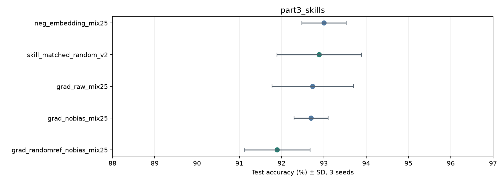

# Data-efficient ModernBERT: первые результаты

**Статус: первая рабочая версия отчета, 18 ноября 2026.** 84 завершенных обучения, 28 условий, по 3 seed на условие. Все результаты ниже получены реальным обучением; accuracy, macro/positive F1 повторно пересчитаны из сохраненных предсказаний. Это исследование отбора данных, без teacher и knowledge distillation.

## Основные результаты

1. Ненормированное выравнивание градиентов дешевой бинарной головы выродилось в классово-асимметричный отбор по трудности: общий баланс меток сохранился, но среди выбранных примеров одного класса proxy ошибался в 100% случаев, другого — в 0%. Качество ModernBERT упало до 75.65–80.39%.
2. Смесь с random и ограничения состава данных устранили катастрофический провал: исходная формула достигла 92.74%, но не превзошла соответствующий matched-random 92.89%. Удаление bias в этом исправленном дизайне дополнительного выигрыша не дало. Смесь и квоты изменены вместе, поэтому их отдельные причинные эффекты не измерены.
3. Heldout-forgetting в первой серии дал +0.73 п.п. к своему random во всех трех seed. В уточненном дизайне 653 нестабильные строки дали +1.03 п.п. к matched-контролю, исключающему все нестабильные строки, но только +0.15 п.п. к обычному random. Это разные сравнения, их нельзя объединять в один headline.
4. Мягкое embedding-нацеливание на отрицания близко к matched-random: 93.00% против 92.89%. Устойчивого превосходства не доказано. Для пар исследована только малая доза; отсутствие эффекта в пилоте не опровергает гипотезу взаимодополняемости.

## Постановка и протокол

- Датасет: GLUE SST-2, pool 65349 / val 2000 / test 872. Val выделен из train стратифицированно, seed42. Test — размеченный GLUE validation, не официальный закрытый GLUE test.
- В каждом обучении 6534 уникальных pool-индекса, исходные gold labels. Размер поднабора округлен до 6534.
- ModernBERT-base: 3 эпохи (615 шагов), batch32, lr5e-5, weight decay0.01, warmup0.06, max length64. Лучшая эпоха определяется по val. Test оценивается после обучения.
- Первая/вторая серии: seeds17/42/101. Исправляющая серия: 202/303/404. Selection seed связан с training seed; независимого факторного исследования их влияния нет.
- Первая серия сравнивается с random; skill-методы второй — с skill_random на том же eligible pool; пары — с pair_random и специальными matched/broken контролями. Контроли третьей серии описаны ниже.
- Все методы используют доступные pool labels. «10%» — объем финального обучения, не экономия 90% разметки или полного вычислительного бюджета. Наш full-100% baseline не запускался; результаты коллеги не выдаются за наши измерения.
- Код CPU-подготовки, manifests, версии модели/датасета и окружение каждого обучения сохранены. Пилот и незавершенная старая вторая очередь исключены из основной таблицы.

SD в таблицах — стандартное отклонение трех результатов, не доверительный интервал. Разности вычислены относительно указанного контроля в той же серии.

## Первая серия: дешевые CPU-селекторы

| Метод | Accuracy ± SD, % | Macro F1, % | Контроль | Δ, п.п. |
|---|---|---|---|---|
| dedup_exact | 92.47 ± 0.35 | 92.47 | random | +0.04 |
| heldout_forgetting | 93.16 ± 0.58 | 93.16 | random | +0.73 |
| lexical_diversity | 92.66 ± 0.30 | 92.65 | random | +0.23 |
| random | 92.43 ± 0.83 | 92.42 | random | +0.00 |
| rare_words | 91.25 ± 1.94 | 91.22 | random | -1.19 |

## Вторая серия: навыки и пары

| Метод | Accuracy ± SD, % | Macro F1, % | Контроль | Δ, п.п. |
|---|---|---|---|---|
| contrast_embedding | 92.01 ± 0.07 | 92.01 | skill_random | -0.99 |
| contrast_gradient | 77.14 ± 1.29 | 76.16 | skill_random | -15.86 |
| contrast_keyword | 92.81 ± 0.18 | 92.81 | skill_random | -0.19 |
| contrast_randomref_gradient | 75.65 ± 5.29 | 74.30 | skill_random | -17.35 |
| negation_embedding | 92.70 ± 0.40 | 92.70 | skill_random | -0.31 |
| negation_gradient | 78.82 ± 3.50 | 77.68 | skill_random | -14.18 |
| negation_keyword | 86.47 ± 2.65 | 86.24 | skill_random | -6.54 |
| negation_randomref_gradient | 80.39 ± 3.29 | 79.83 | skill_random | -12.61 |
| pair_broken_pairs | 92.89 ± 0.34 | 92.89 | pair_random | -0.08 |
| pair_matched_random | 93.35 ± 0.53 | 93.35 | pair_random | +0.38 |
| pair_pairs | 92.85 ± 1.15 | 92.85 | pair_random | -0.11 |
| pair_random | 92.97 ± 0.63 | 92.96 | pair_random | +0.00 |
| skill_random | 93.00 ± 0.46 | 93.00 | skill_random | +0.00 |

## Третья серия: исправления и абляции

| Метод | Accuracy ± SD, % | Macro F1, % | Контроль | Δ, п.п. |
|---|---|---|---|---|
| forget_all | 92.55 ± 0.61 | 92.54 | forget_matched_zero | +0.69 |
| forget_dose05 | 92.24 ± 0.81 | 92.23 | forget_matched_zero | +0.38 |
| forget_dose10 | 92.89 ± 0.41 | 92.88 | forget_matched_zero | +1.03 |
| forget_matched_zero | 91.86 ± 0.41 | 91.85 | forget_matched_zero | +0.00 |
| forget_random | 92.74 ± 0.18 | 92.73 | forget_matched_zero | +0.88 |
| grad_nobias_mix25 | 92.70 ± 0.40 | 92.69 | skill_matched_random_v2 | -0.19 |
| grad_randomref_nobias_mix25 | 91.90 ± 0.78 | 91.88 | skill_matched_random_v2 | -0.99 |
| grad_raw_mix25 | 92.74 ± 0.96 | 92.73 | skill_matched_random_v2 | -0.15 |
| neg_embedding_mix25 | 93.00 ± 0.53 | 93.00 | skill_matched_random_v2 | +0.11 |
| skill_matched_random_v2 | 92.89 ± 1.00 | 92.88 | skill_matched_random_v2 | +0.00 |

## Интерпретация первой серии

- `heldout_forgetting`: 93.16% против random92.43%; парные разности +0.57/+1.03/+0.57 п.п. На деле это небольшая добавка: ненулевой OOF correct→incorrect score есть у 878–951 строк, остальные 5583–5656 строк в top-6534 добраны при нулевом score. Это не классический training-forgetting и не точное воспроизведение SVP.
- `dedup_exact`: эффект +0.04 п.п.; в pool всего347 повторных строк (0.53%), в random-поднаборах по2 повторных текста. Сильного воздействия ожидать трудно.
- `lexical_diversity`: доля уникальных слов внутри текста, не разнообразие всего набора. Смещает выбор к коротким фразам; +0.23 п.п. неустойчивы по seed.
- `rare_words`: медиана длины2 слова, одинаковая подвыборка во всех seed; 91.25% и большой разброс. Сохраняем как отрицательный результат, не расширяем похожие на работу коллег длиновые/очистительные эвристики.

## Почему сломался градиентный отбор

Для бинарной головы g_i=(p_i−y_i)[h_i;1]. Score — скалярное произведение g_i с усредненным reference-градиентом. Формула проверена сравнением с autograd.

На всех eligible-кандидатах проекция `h·mean(g_ref,w)+mean(g_ref,b)` имела один знак: для negation от −0.1310 до −0.0916, для contrast от +0.0444 до +0.0768. Рейтинг внутри каждого класса почти совпал с loss или −loss (|Spearman|=0.992–0.999). Выбирались трудные строки одного класса и легкие другого. Ошибка proxy не доказывает ошибку gold-разметки; такие случаи нельзя автоматически называть шумом.

CPU-абляция показала, что удаление bias и центрирование по классам сами по себе перекос не устраняют. Поэтому исправляющая серия сохранила точные квоты по label × length-bin × proxy-correctness × loss-quintile и общий ~75% фон. Только ~25% заменяются targeted-строками. Ошибка proxy по классам теперь одинакова во всех пяти условиях: 20.66% и 14.32%. Квоты сохраняют распределение по бинам, а не точные непрерывные loss/длины.

В этой серии raw-mix92.74%, no-bias92.70%, random-reference no-bias91.90%, matched-random92.89%. Target-reference лучше random-reference в среднем, но ниже/близок к основному контролю; три seed недостаточны для сильного вывода о reference-специфичности. Это эксперимент с дешевой MiniLM-головой, не воспроизведение LESS.

## Что показала дозировка forgetting

Для третьей серии зафиксирован исходный OOF score seed17: 932 nonzero строки. Новые seed меняют выбор matched-контролей, фона и обучение, а не proxy-score. Общий фон5602 строки; каждой из932 targeted-строк сопоставлена zero-score замена того же класса и бина длины. Замены вложенные: 0 / 327 / 653 / 932. Полный random добавлен отдельным контролем.

Средние accuracy: matched-zero91.86%; 327 —92.24%; 653 —92.89%; 932 —92.55%; обычный random92.74%. Наибольшая наблюдаемая прибавка к matched-zero +1.03 п.п.; к обычному random только +0.15 п.п. При 932 строках результат ниже, поэтому монотонная польза увеличения дозы не подтверждается. Доза653 — лучший из проверенных вариантов, а не доказанный оптимум.

## Навыки и пары

Первый negation_embedding дал +1.63 п.п. на лексическом negation-срезе и −0.31 п.п. overall. При мягком отборе в третьей серии разница к своему контролю составляет +0.11 п.п. overall и лишь +0.20 п.п. на negation: старый локальный сигнал не воспроизвелся в заметном размере. Срезы заданы маркерами, а не независимо проверенными языковыми способностями.

В старом negation_keyword все label0-строки содержали отрицание, а среди label1 —43.57%. Это сильная искусственная связь между маркером и меткой; общий class balance не предотвращает shortcut.

Парный пилот: 468 широких кандидатов, 43 с операторами отрицания/отсутствия, после предварительного assistant-review39 непересекающихся пар. Используются32 пары,64 строки (0.98% бюджета). В `broken_pairs` заменены32 строки, остальные6502 общие. Средняя pairs−broken разность −0.04 п.п., знаки по seed разные. Обучение обычным CE, без pair-loss; pair-consistency на независимом наборе не измерена.

Расширенный CPU-поиск до двух токенов дал1080 кандидатов,825 непересекающихся по greedy matching; в категории operator insertion/deletion165 кандидатов,141 непересекающаяся. **Они не проверены и не использовались в обучении.** Увеличение числа кандидатов не означает увеличение числа корректных смысловых пар.

## Ограничения и честность выводов

- Три seed; малые выигрыши порядка0.1–0.2 п.п. не объявляются значимыми. При сравнении28 условий есть риск случайного лучшего результата. T-интервалы в CSV условны на один test, не скорректированы за множественные сравнения и не заменяют независимое подтверждение.
- Test уже повлиял на дизайн третьей серии. Поэтому ее результаты exploratory. Нельзя настраивать следующие гиперпараметры по тому же test и называть это независимой проверкой.
- Negation/contrast-срезы малы:164/121 строки и могут пересекаться. Reference определены лексически, без независимой человеческой сертификации.
- У нескольких исходных методов подвыборка одинакова между seed; разброс отражает только обучение. Источники вариативности нельзя считать одинаковыми для всей таблицы.
- Найдены24 точных текстовых совпадения val с pool после strip/lowercase; точных pool/test и val/test совпадений нет. Родство фрагментов одного исходного предложения не проверено. Для нового group-aware val потребуются восстановление source IDs и новые контролы; текущие результаты не переписываются.
- В третьей серии одновременно введены смесь и квоты. Улучшение относительно исходного провала нельзя причинно приписать одному из этих изменений.
- `last_session_seconds` не включает всю CPU-подготовку, загрузку и предыдущие прерывания; честное end-to-end сравнение времени еще не сделано.
- В старом `code_restart` identity хешировал соседнюю `code`. Отличие исполненной версии касалось retention checkpoint; обе версии сохранены в executed_code. В переносимом trainer вычисляется хеш реально исполняемой папки.
- Итоговые веса моделей не сохранены: trainer удалял checkpoint после успешного завершения. Для новых поведенческих тестов старых моделей потребуется переобучение. Метрики, предсказания и входные manifests сохранены полностью.

## Что считаем завершенным и что оставляем на потом

Сохраняем все отрицательные результаты. Не расширяем exact-dedup, lexical-ratio, rare-word и старый hard keyword/gradient top-k без новой гипотезы. Raw-gradient failure плюс контролируемое восстановление — содержательный результат даже без выигрыша над random. Forgetting и мягкий embedding остаются кандидатами для независимой проверки, не готовыми победителями.

Следующий отдельный этап: проверка расширенного банка пар и независимый behavioral evaluation. Новые GPU-запуски для текущей версии отчета не требуются.

## Артефакты и воспроизведение

- [Все84 запуска](results/analysis/all_runs.csv), [28 сводных условий](results/analysis/all_summary.csv), [парные сравнения третьей серии](results/analysis/followup_comparisons.csv).
- [Проверки метрик и сплитов](results/analysis/verification.json), [исходная диагностика градиентов](results/analysis/gradient_geometry.csv), [связь с loss](results/analysis/gradient_loss_correlations.csv).
- [Дозировки и состав третьей серии](results/preparation/part3/selection_audit.csv), [зафиксированный протокол](experiments/03_followups/PROTOCOL.md).
- [Непроверенные новые пары](results/pairs_v2_candidates/stats.json).
- `results/raw/part*/runs/`: metrics, predictions, identity, environment каждого запуска. `results/selections/`: хешированные индексы; `results/inputs/`: CPU-оценки и provenance.
- [README](README.md) — команды воспроизведения и структура. `results/ARTIFACT_SHA256.json` — проверяемый манифест артефактов.

## Что еще оформить в следующей редакции

- Добавить литературный обзор и явно сопоставить наши упрощения с исходными методами, не выдавая их за точные воспроизведения.
- Дополнить текст несколькими проверенными примерами выбранных фраз; не выбирать примеры как доказательство эффекта по test.
- Согласовать с командой финальную таблицу и протокол full-data baseline. Не смешивать числа разных сплитов/настроек без проверки.

Это редакционные и исследовательские хвосты, а не отсутствующие результаты перечисленных84 запусков.

## Карточки всех условий

- [part1_dedup_exact](results/methods/part1_dedup_exact.md)
- [part1_heldout_forgetting](results/methods/part1_heldout_forgetting.md)
- [part1_lexical_diversity](results/methods/part1_lexical_diversity.md)
- [part1_random](results/methods/part1_random.md)
- [part1_rare_words](results/methods/part1_rare_words.md)
- [part2_contrast_embedding](results/methods/part2_contrast_embedding.md)
- [part2_contrast_gradient](results/methods/part2_contrast_gradient.md)
- [part2_contrast_keyword](results/methods/part2_contrast_keyword.md)
- [part2_contrast_randomref_gradient](results/methods/part2_contrast_randomref_gradient.md)
- [part2_negation_embedding](results/methods/part2_negation_embedding.md)
- [part2_negation_gradient](results/methods/part2_negation_gradient.md)
- [part2_negation_keyword](results/methods/part2_negation_keyword.md)
- [part2_negation_randomref_gradient](results/methods/part2_negation_randomref_gradient.md)
- [part2_pair_broken_pairs](results/methods/part2_pair_broken_pairs.md)
- [part2_pair_matched_random](results/methods/part2_pair_matched_random.md)
- [part2_pair_pairs](results/methods/part2_pair_pairs.md)
- [part2_pair_random](results/methods/part2_pair_random.md)
- [part2_skill_random](results/methods/part2_skill_random.md)
- [part3_forget_all](results/methods/part3_forget_all.md)
- [part3_forget_dose05](results/methods/part3_forget_dose05.md)
- [part3_forget_dose10](results/methods/part3_forget_dose10.md)
- [part3_forget_matched_zero](results/methods/part3_forget_matched_zero.md)
- [part3_forget_random](results/methods/part3_forget_random.md)
- [part3_grad_nobias_mix25](results/methods/part3_grad_nobias_mix25.md)
- [part3_grad_randomref_nobias_mix25](results/methods/part3_grad_randomref_nobias_mix25.md)
- [part3_grad_raw_mix25](results/methods/part3_grad_raw_mix25.md)
- [part3_neg_embedding_mix25](results/methods/part3_neg_embedding_mix25.md)
- [part3_skill_matched_random_v2](results/methods/part3_skill_matched_random_v2.md)
