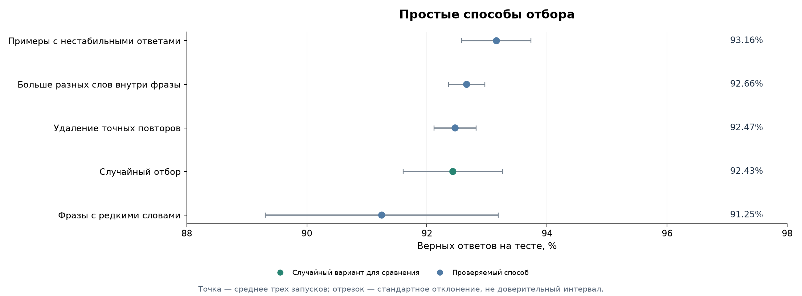
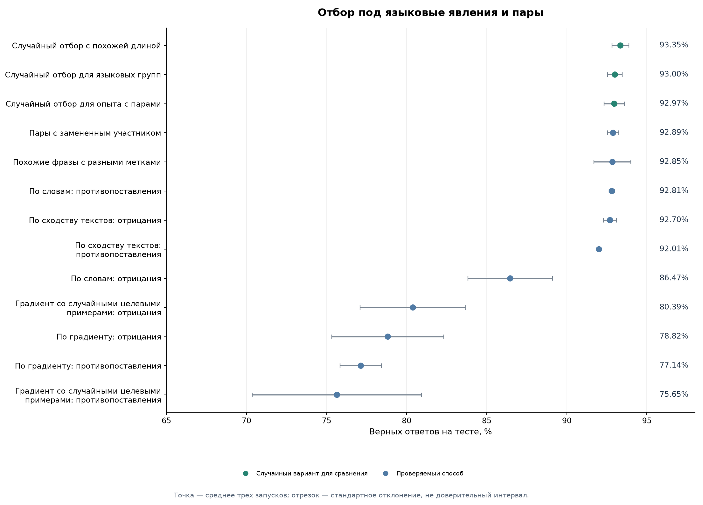
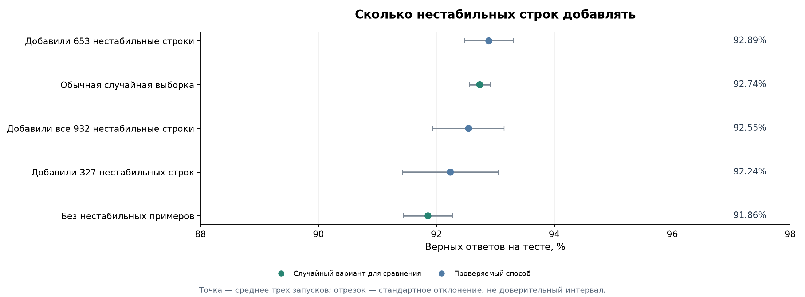

# Как выбрать 10% данных для обучения ModernBERT

**Первые результаты · 18 ноября 2026 · 84 обучения · 28 условий · 3 запуска на условие**

## Главное за минуту

**Устойчивого выигрыша над случайным отбором мы пока не получили. Но нашли сильный перекос в данных одного из подходов и проверили исправление.**

| Что проверяли | Что получили | Что это значит |
|---|---|---|
| Добавку примеров с нестабильными ответами маленькой модели | Сначала **+0.73 п.п.** к случайному отбору. В следующем опыте лучший вариант дал **+0.15 п.п.** к обычной случайной выборке | Идея заслуживает внимания, но первый выигрыш не повторился в том же размере |
| Отбор по градиенту — ожидаемому изменению параметров модели | **75.65–80.39%** верных ответов вместо **93.00%** у случайного варианта | Отбор создал сильный перекос: легкие примеры одного класса и трудные другого |
| Ограничения состава данных и 75% случайного фона | Точность вернулась к **92.74%**, контроль — **92.89%** | Провал исчез, но преимущества над честным случайным сравнением нет |
| Небольшую добавку фраз, похожих на примеры отрицаний | **93.00%** против **92.89%** у контроля | Разница слишком мала, чтобы объявлять успех |
| Похожие пары фраз с разными метками | Преимущества не нашли при **32 парах** | Парные строки занимали меньше 1% набора. Большую идею проверили пока слишком слабо |

Ниже — что мы ожидали, что сделали и как наши результаты соотносятся со статьями. Числа из статей **не являются прямым соревнованием** с нашими: задачи, модели и доли данных отличаются.

## Что и как обучали

Модель определяет, положительный или отрицательный отзыв перед ней. Из 65 349 доступных строк SST-2 каждый способ выбирает **6534 строки — около 10%**. Затем на них обучается ModernBERT-base. Учителя и дистилляции нет.

Отдельные 2000 строк нужны для выбора лучшего состояния модели во время обучения. Итоговая проверка идет на других 872 строках — размеченной проверочной части GLUE SST-2. Здесь мы называем ее тестом; это не закрытый официальный GLUE test.

Все модели обучались три прохода по выбранным данным с одинаковыми настройками. Каждый вариант запускали трижды. Номер случайного запуска (*seed*) задает случайность выбора данных и обучения. Подробные настройки вынесены в [технические пояснения](docs/TECHNICAL_NOTES.md).

**Как читать таблицы:**

- **Верных ответов, %** — средняя accuracy трех запусков. Больше — лучше.
- **Разброс** — стандартное отклонение результатов между запусками. Это не доверительный интервал.
- **Разница, п.п.** — разница в процентных пунктах с указанным случайным вариантом. Например, 93% против 92% — это +1 п.п.
- F1 и результаты каждого запуска доступны в карточке метода: название в таблице ведет на нее. F1 учитывает не только число верных ответов, но и баланс между пропущенными и ошибочно назначенными метками.

У каждой серии **свой случайный вариант**: доступные строки и ограничения отбора различаются. Сравнивать все методы с одним общим числом нельзя.

## 1. Простые способы отбора

### Нестабильные примеры: главный положительный сигнал

**Зачем пробовали.** Если маленькая модель то понимает пример, то ошибается, в нем может быть полезное различие, которое трудно выучить.

**Что сделали.** Считали, сколько раз ответ простой текстовой модели менялся с правильного на неправильный. Каждую строку оценивала модель, которая не училась на этой строке. Нестабильных строк нашлось 878–951. Весь бюджет они не заполняли: остальные места выбирались случайно.

**Что получилось.** 93.16% против 92.43% у случайного отбора. Разницы в трех запусках: **+0.57, +1.03 и +0.57 п.п.**

**Что это значит.** Это повод проверить небольшую полезную добавку к случайному набору. Пока это не доказательство того, что можно надежно ранжировать все строки по полезности. Проверка размера добавки — в разделе 4.

**В статье.** [Toneva и соавторы](https://arxiv.org/abs/1812.05159) могли убрать до 30% CIFAR-10 без заметного ухудшения. Они в первую очередь убирали примеры, которые нейросеть не забывала. Мы решали более жесткую задачу: оставляли только 10% SST-2. Кроме того, считали нестабильность другой модели на строках вне ее обучения. Это перенос идеи, а не точное повторение статьи.

Идея оценивать данные дешевой моделью также связана с [Selection via Proxy](https://arxiv.org/abs/1906.11829). В этой работе на CIFAR-10 удавалось убрать до 50% данных без потери точности, используя для отбора модель, которая обучалась более чем в 10 раз быстрее. У нас другая оценка примеров, поэтому этот результат нельзя обещать заранее.

### Удаление повторов

**Зачем пробовали.** Повторяющиеся тексты могут занимать место, не добавляя информации.

**Что сделали.** Убрали точные повторы строк и затем выбрали случайный поднабор.

**Результат и вывод.** 92.47% против 92.43%: почти без изменений. Во всем наборе лишь 347 повторных строк, а в каждом случайном поднаборе — по две. Мы слишком мало меняли данные, чтобы ждать большой разницы.

**В статье.** [Lee и соавторы](https://arxiv.org/abs/2107.06499) удаляли повторы из больших наборов для обучения языковых моделей. После очистки модели выдавали запомненные фрагменты примерно в 10 раз реже. У нас задача классификации, только точные повторы и гораздо меньшая их доля. Наш нулевой эффект не противоречит их результату.

### Разнообразие слов и редкие слова

**Зачем пробовали.** Возможно, фразы с более разнообразными или редкими словами дают больше новой информации.

**Что сделали.** В одном варианте выбирали высокую долю уникальных слов внутри фразы. В другом — высокую среднюю редкость слов.

**Результат и вывод.** Разнообразие слов дало неустойчивые +0.23 п.п., редкие слова — в среднем -1.19 п.п. Оба правила тянутся к коротким фразам; у варианта с редкими словами медиана длины — два слова. Простая лексическая оценка не гарантирует полезность текста.

**Источник идеи.** [Обзор отбора данных](https://arxiv.org/abs/2408.02085) обсуждает разнообразие как одно из направлений. Но эти две формулы — **наши простые проверки**, а не воспроизведение конкретного метода из обзора.

Сравнение со случайным отбором первой серии.

| Как выбирали данные | Верных ответов, % | Разброс, п.п. | Разница, п.п. |
|---|---|---|---|
| [Случайный отбор](results/methods/part1_random.md) | 92.43 | 0.83 | — |
| [Примеры с нестабильными ответами](results/methods/part1_heldout_forgetting.md) | 93.16 | 0.58 | +0.73 |
| [Удаление точных повторов](results/methods/part1_dedup_exact.md) | 92.47 | 0.35 | +0.04 |
| [Больше разных слов внутри фразы](results/methods/part1_lexical_diversity.md) | 92.66 | 0.30 | +0.23 |
| [Фразы с редкими словами](results/methods/part1_rare_words.md) | 91.25 | 1.94 | -1.19 |

## 2. Отбор под отрицания и противопоставления

### По ключевым словам и сходству текстов

**Зачем пробовали.** Модель может лучше понимать отрицания, если показать ей больше подходящих фраз. Аналогично — с противопоставлениями вроде «хорошо, но скучно».

**Что сделали.** Для отрицаний искали слова `not`, `never`, `no`, `n't`; для противопоставлений — `but`, `although`, `however`, `yet`. В отдельном варианте MiniLM переводил фразы в числовые представления, и мы выбирали похожие на целевые примеры тексты.

**Что получилось.**

- Жесткий отбор по словам отрицания снизил точность до **86.47%**. Все выбранные отрицательные отзывы содержали такой маркер, а положительные — только в 43.57% случаев. Мы создали искусственную подсказку, связанную с меткой.
- Отбор по сходству для отрицаний дал **92.70%** против **93.00%** у контроля. На 164 фразах с отрицаниями был плюс **1.63 п.п.**, но на всем тесте — минус **0.31 п.п.**
- Отбор по сходству для противопоставлений дал **92.01%**. Небольшой плюс на своей группе не компенсировал общее снижение.

**Что это значит.** Похожесть на нужные фразы и наличие слов-маркеров не гарантируют полезную обучающую выборку. Важно показывать и общий результат, и результат на целевой группе.

**В статьях.** [Sentence-BERT](https://arxiv.org/abs/1908.10084) показал, как быстро сравнивать смысл предложений. Это не доказательство того, что близкие к среднему примеры — лучший выбор для обучения. Мы использовали готовый MiniLM из Sentence Transformers; правило отбора — наше.

[CheckList](https://arxiv.org/abs/2005.04118) показывает пользу отдельных тестов языковых явлений. В одном исследовании с его помощью нашли почти втрое больше ошибок. Но наш набор фраз со словом `not` еще не является таким проверенным тестом. Называть это доказанным пониманием отрицаний рано.

### По градиенту: почему результат резко ухудшился

**Зачем пробовали.** Градиент показывает, как пример предлагает изменить параметры модели. Мы хотели выбирать примеры, изменения от которых помогали бы отвечать на целевые фразы.

**Что сделали.** Сравнивали градиенты простой модели поверх MiniLM с общим градиентом целевых примеров. Еще в двух вариантах заменили целевые примеры случайными — чтобы проверить их роль.

**Что получилось.** Во всех четырех вариантах точность упала до **75.65–80.39%** вместо **93.00%**.

**Почему.** Число положительных и отрицательных меток оставалось правильным, но внутри классов появился сильный перекос. В выбранных данных маленькая модель ошибалась на **100% примеров одного класса и на 0% другого**. Оценка почти превратилась в правило «брать трудные примеры одного класса и легкие другого».

Это проверено по сохраненным оценкам. Однако ошибка маленькой модели **не доказывает ошибку разметки**: пример может быть трудным и при этом правильно размеченным.

**В статье.** [LESS](https://arxiv.org/abs/2402.04333) в ряде задач получал на выбранных 5% данных результат выше, чем на всем наборе. Но авторы учитывали устройство Adam, несколько этапов обучения и сравнивали нормированные градиенты языковой модели. Мы использовали гораздо более простую модель и обычное скалярное произведение.

Есть важное сходство: **в самой статье LESS простое скалярное произведение тоже иногда работало хуже случайного отбора**. Там оно выбирало слишком короткие обучающие тексты. У нас обнаружен другой перекос — по трудности между классами. Общий урок похож: удобная численная оценка может отбирать не то, ради чего ее вводили. Но наш опыт не опровергает LESS.

Сравнение со случайным отбором из тех же доступных строк.

| Как выбирали данные | Верных ответов, % | Разброс, п.п. | Разница, п.п. |
|---|---|---|---|
| [Случайный отбор для языковых групп](results/methods/part2_skill_random.md) | 93.00 | 0.46 | — |
| [По словам: отрицания](results/methods/part2_negation_keyword.md) | 86.47 | 2.65 | -6.54 |
| [По словам: противопоставления](results/methods/part2_contrast_keyword.md) | 92.81 | 0.18 | -0.19 |
| [По сходству текстов: отрицания](results/methods/part2_negation_embedding.md) | 92.70 | 0.40 | -0.31 |
| [По сходству текстов: противопоставления](results/methods/part2_contrast_embedding.md) | 92.01 | 0.07 | -0.99 |
| [По градиенту: отрицания](results/methods/part2_negation_gradient.md) | 78.82 | 3.50 | -14.18 |
| [По градиенту: противопоставления](results/methods/part2_contrast_gradient.md) | 77.14 | 1.29 | -15.86 |
| [Градиент со случайными целевыми примерами: отрицания](results/methods/part2_negation_randomref_gradient.md) | 80.39 | 3.29 | -12.61 |
| [Градиент со случайными целевыми примерами: противопоставления](results/methods/part2_contrast_randomref_gradient.md) | 75.65 | 5.29 | -17.35 |

## 3. Пары похожих фраз с разными метками

**Зачем пробовали.** Две почти одинаковые фразы с разным смыслом могут показать модели, какое небольшое изменение действительно важно для ответа.

**Как искали пары.** Требовали одинаковое начало и конец фразы, изменение не более одного токена и противоположные исходные метки SST-2. Затем оставляли вставку или удаление явного отрицания либо отсутствия. После предварительной проверки ассистентом, без независимой человеческой разметки, осталось 39 пар без общих участников. В обучение добавили 32 пары.

**Как сравнивали.** Были обычный случайный набор, случайный набор с похожей длиной фраз и вариант, где один участник каждой пары заменен. Между целыми и «разбитыми» парами менялись только **32 строки из 6534**.

**Результат и вывод.** 92.85% у целых пар против 92.89% у разбитых. Разница меняет знак между запусками. Преимущества не нашли, но парные строки занимали всего **0.98% набора**. Это небольшой пробный опыт, а не достаточная проверка всей идеи.

**В статье.** [Kaushik и соавторы](https://arxiv.org/abs/1909.12434) просили людей менять тексты IMDb и SNLI так, чтобы менялся правильный ответ, но лишних правок было мало. Обучение на исходных и измененных текстах вместе помогало лучше работать на обоих видах данных. У нас пары найдены автоматически в другом наборе, их намного меньше, а отдельного теста на измененные фразы нет. Условия пока слишком разные для прямого сравнения.

Сравнение с обычным случайным набором парной серии.

| Как выбирали данные | Верных ответов, % | Разброс, п.п. | Разница, п.п. |
|---|---|---|---|
| [Случайный отбор для опыта с парами](results/methods/part2_pair_random.md) | 92.97 | 0.63 | — |
| [Случайный отбор с похожей длиной](results/methods/part2_pair_matched_random.md) | 93.35 | 0.53 | +0.38 |
| [Похожие фразы с разными метками](results/methods/part2_pair_pairs.md) | 92.85 | 1.15 | -0.11 |
| [Пары с замененным участником](results/methods/part2_pair_broken_pairs.md) | 92.89 | 0.34 | -0.08 |

Высокое среднее у случайного набора с похожей длиной **не делает его новым победителем**: плюс к обычному random был только в одном запуске из трех.

## 4. Проверка исправлений

### Сколько нестабильных примеров добавлять

**Вопрос.** Помогает ли именно небольшая добавка таких строк и становится ли лучше, если добавлять больше?

**Что сделали.** Зафиксировали 932 нестабильные строки из оценки первой серии. К общим 5602 строкам добавляли 0, 327, 653 или 932 из них. Для остальных мест брали замены той же метки и близкой длины. Отдельно обучили обычную случайную выборку.

| Как выбирали данные | Верных ответов, % | Разброс, п.п. | К обычной случайной, п.п. | К набору без нестабильных, п.п. |
|---|---|---|---|---|
| [Обычная случайная выборка](results/methods/part3_forget_random.md) | 92.74 | 0.18 | — | +0.88 |
| [Без нестабильных примеров](results/methods/part3_forget_matched_zero.md) | 91.86 | 0.41 | -0.88 | — |
| [Добавили 327 нестабильных строк](results/methods/part3_forget_dose05.md) | 92.24 | 0.81 | -0.50 | +0.38 |
| [Добавили 653 нестабильные строки](results/methods/part3_forget_dose10.md) | 92.89 | 0.41 | +0.15 | +1.03 |
| [Добавили все 932 нестабильные строки](results/methods/part3_forget_all.md) | 92.55 | 0.61 | -0.19 | +0.69 |

**Вывод.** Вариант с 653 строками дал **+1.03 п.п.** к набору, где нестабильных строк нет совсем. Но к обычной случайной выборке плюс лишь **+0.15 п.п.** Поэтому нельзя писать просто «метод улучшил результат на процентный пункт».

Добавление всех 932 строк не улучшило результат дальше. Лучшее из проверенных чисел — 653; это не доказанное лучшее число для любого запуска или набора данных.

**Связь со статьей.** Продолжаем идею забывания примеров из [Toneva и соавторов](https://arxiv.org/abs/1812.05159), но проверка именно такой дозы — наш собственный опыт. В статье нет результата, с которым можно напрямую сравнить эти 653 строки SST-2.

### Можно ли убрать провал градиентного отбора

**Вопрос.** Если сохранить нормальный состав данных, останется ли польза от градиентной оценки?

**Что сделали.** Около 75% строк оставили общими и случайными. Остальные выбирали целевым способом, но в одинаковых группах по метке, длине и трудности для маленькой модели. Теперь доля ее ошибок внутри каждого класса одинакова у всех пяти вариантов.

Отдельно убрали из градиента **bias** — свободный параметр, который сдвигает ответ независимо от текста. Также проверили случайные целевые примеры и мягкий отбор по сходству фраз.

Сравнение со случайным набором того же состава.

| Как выбирали данные | Верных ответов, % | Разброс, п.п. | Разница, п.п. |
|---|---|---|---|
| [Случайный набор с заданным составом](results/methods/part3_skill_matched_random_v2.md) | 92.89 | 1.00 | — |
| [25% по исходному градиенту](results/methods/part3_grad_raw_mix25.md) | 92.74 | 0.96 | -0.15 |
| [25% по градиенту без bias](results/methods/part3_grad_nobias_mix25.md) | 92.70 | 0.40 | -0.19 |
| [25% по градиенту со случайным ориентиром](results/methods/part3_grad_randomref_nobias_mix25.md) | 91.90 | 0.78 | -0.99 |
| [25% похожих на примеры с отрицанием](results/methods/part3_neg_embedding_mix25.md) | 93.00 | 0.53 | +0.11 |

**Что это значит.**

- Провал исчез: исходная градиентная формула в новых условиях дала **92.74%**. Но случайный контроль дает **92.89%**.
- Удаление bias не добавило пользы: **92.70%**. Нельзя объяснять исправление только удалением этого параметра.
- Мягкий отбор по сходству дал **93.00%**. Разница с контролем — **+0.11 п.п.**; на фразах с отрицанием — всего **+0.20 п.п.** Заметного повторения старого выигрыша на этой группе нет.

Мы одновременно изменили долю целевых строк и ограничения состава. Этот опыт не разделяет вклад двух изменений. Исправление провала — полезный результат, но пока не новый способ надежно обойти случайный отбор.

**Связь со статьями.** Это наши проверки причин сбоя. Они не повторяют устройство LESS и не должны называться «улучшенным LESS». Аналогично смесь похожих фраз со случайным фоном не была проверена в статье Sentence-BERT как готовый метод отбора SST-2.

## Что оставляем, а что стоит продолжить

| Направление | Решение |
|---|---|
| Удаление повторов, доля уникальных слов, редкие слова | Сохранить как законченные простые проверки. Расширять пока не нужно |
| Нестабильные примеры | Оставить кандидатом для новой независимой проверки; пока не объявлять победителем |
| Исходный градиентный отбор | Сохранить провал и объяснение. Без изменений больше не запускать |
| Исправления градиентного отбора | Сохранить как проверку причин сбоя. Качество восстановили, превосходства над random нет |
| Сходство с фразами отрицания | Малый и неустойчивый выигрыш. Для сильного вывода нужен отдельный тест |
| Пары | Сначала расширить и проверить пары, затем возвращаться к обучению |

Расширенный поиск с изменением до двух токенов уже дал **1080 кандидатов**. Среди них 165 вставок/удалений слов отрицания или отсутствия; 141 пара в этой группе не имеет общих участников. **Новые кандидаты не проверены и в обучение не входили.**

## Что ограничивает выводы

1. **Всего три запуска на условие.** Разницы в 0.1–0.2 п.п. слишком малы для уверенного вывода. Лучший результат среди многих вариантов может оказаться случайным.
2. **Тест уже повлиял на следующую серию.** Мы посмотрели первые результаты и придумали исправления. Поэтому третья серия — уточнение гипотез, а не независимое подтверждение.
3. **Группы языковых фраз малы.** В тесте 164 строки с маркерами отрицания и 121 — с противопоставлением. Некоторые строки входят в обе группы. Наличие слова не заменяет проверку смысла человеком.
4. **Случайность отличается между методами.** У некоторых во всех трех запусках один и тот же набор текстов; меняется только обучение. У других меняются и данные, и обучение.
5. **Внутренняя проверка не идеальна.** 24 текста из набора для выбора состояния модели совпадают с текстами в доступном обучающем наборе. Совпадений с итоговым тестом по точному тексту нет. Родство фрагментов одного исходного предложения пока не проверено.
6. **10% — не весь бюджет проекта.** Для отбора доступны метки всего набора. Подготовка и обучение маленьких моделей тоже требуют времени. Мы не измерили экономию полного процесса и не запускали свой вариант на 100% данных.
7. **Весов старых моделей нет.** Сохранены предсказания и метрики, но для нового теста старой модели потребуется повторное обучение.

Подробности расчетов и воспроизводимости — в [технических пояснениях](docs/TECHNICAL_NOTES.md). Они вынесены отдельно, чтобы не мешать чтению результатов.

## Где лежат результаты и источники

- [Все 84 запуска](results/analysis/all_runs.csv) и [сводка 28 условий](results/analysis/all_summary.csv).
- [Сравнения исправляющей серии по каждому запуску](results/analysis/followup_comparisons.csv).
- [Все статьи: что именно проверено и что можно сравнивать](docs/SOURCES.md).
- [Инструкция запуска и структура проекта](README.md).

## Карточки методов

### Простые способы

- [Удаление точных повторов](results/methods/part1_dedup_exact.md)
- [Примеры с нестабильными ответами](results/methods/part1_heldout_forgetting.md)
- [Больше разных слов внутри фразы](results/methods/part1_lexical_diversity.md)
- [Случайный отбор](results/methods/part1_random.md)
- [Фразы с редкими словами](results/methods/part1_rare_words.md)

### Языковые группы и пары

- [По сходству текстов: противопоставления](results/methods/part2_contrast_embedding.md)
- [По градиенту: противопоставления](results/methods/part2_contrast_gradient.md)
- [По словам: противопоставления](results/methods/part2_contrast_keyword.md)
- [Градиент со случайными целевыми примерами: противопоставления](results/methods/part2_contrast_randomref_gradient.md)
- [По сходству текстов: отрицания](results/methods/part2_negation_embedding.md)
- [По градиенту: отрицания](results/methods/part2_negation_gradient.md)
- [По словам: отрицания](results/methods/part2_negation_keyword.md)
- [Градиент со случайными целевыми примерами: отрицания](results/methods/part2_negation_randomref_gradient.md)
- [Пары с замененным участником](results/methods/part2_pair_broken_pairs.md)
- [Случайный отбор с похожей длиной](results/methods/part2_pair_matched_random.md)
- [Похожие фразы с разными метками](results/methods/part2_pair_pairs.md)
- [Случайный отбор для опыта с парами](results/methods/part2_pair_random.md)
- [Случайный отбор для языковых групп](results/methods/part2_skill_random.md)

### Проверка исправлений

- [Добавили все 932 нестабильные строки](results/methods/part3_forget_all.md)
- [Добавили 327 нестабильных строк](results/methods/part3_forget_dose05.md)
- [Добавили 653 нестабильные строки](results/methods/part3_forget_dose10.md)
- [Без нестабильных примеров](results/methods/part3_forget_matched_zero.md)
- [Обычная случайная выборка](results/methods/part3_forget_random.md)
- [25% по градиенту без bias](results/methods/part3_grad_nobias_mix25.md)
- [25% по градиенту со случайным ориентиром](results/methods/part3_grad_randomref_nobias_mix25.md)
- [25% по исходному градиенту](results/methods/part3_grad_raw_mix25.md)
- [25% похожих на примеры с отрицанием](results/methods/part3_neg_embedding_mix25.md)
- [Случайный набор с заданным составом](results/methods/part3_skill_matched_random_v2.md)

