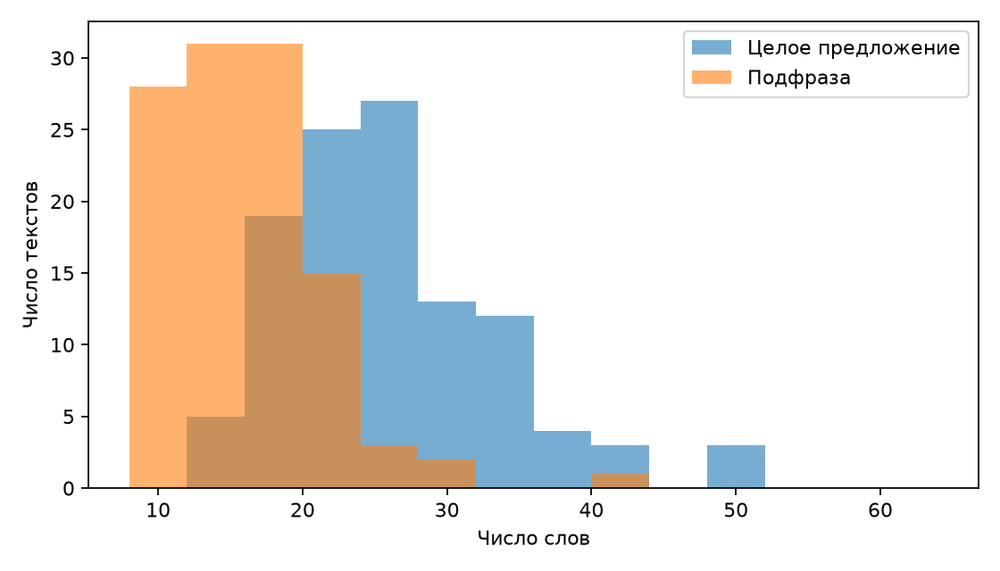

# Подготовка завершена

6658 допустимых целых предложений. Автоматические фильтры: 166 непересекающихся пар. Текстовый просмотр ассистентом: 111 пар. Подготовлены 12 выборок по 6534 строки; 3 варианта смеси используют одинаковые тексты.

CPU-тесты включают двухшаговое обучение небольшой случайно инициализированной ModernBERT. Метрик экспериментального ModernBERT-base пока нет.
