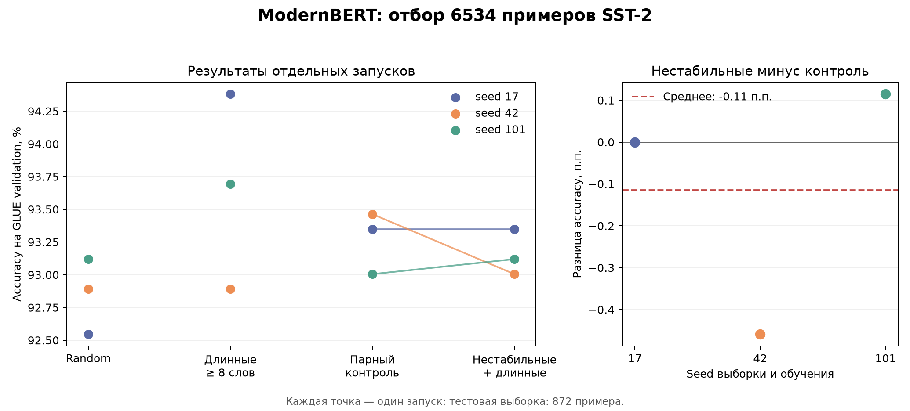

# Длинные и нестабильные примеры для SST-2

**ИТОГ: 12 из 12 обучений.**

## Условия

ModernBERT-base обучается три эпохи на 6534 примерах (10% пула).
Условия `len8_matched_random` и `len8_forgetting` содержат 6207 общих строк длиной ≥ 8 слов;
оставшиеся 327 различаются: нулевой или положительный held-out forgetting score.
Заменяемые строки сопоставлены по метке и группе длины. Прокси и отбор используют метки всего пула.
Скоры получены ранее TF-IDF + SGD на примерах вне обучения соответствующего proxy;
используются архивные сиды 17, 42, 101. Оценка — accuracy и F1 на GLUE validation из 872 строк;
лучшая эпоха выбирается по выделенным из train 2000 строкам.

## Результаты

Показаны средние и выборочное стандартное отклонение (SD) по запускам;
SD не является доверительным интервалом.

| Метод | Запусков | Accuracy ± SD | Macro F1 ± SD | Positive F1 |
|---|---:|---:|---:|---:|
| `random` | 3 | 92.85% ± 0.29% | 92.84% ± 0.29% | 93.09% |
| `len8` | 3 | 93.65% ± 0.75% | 93.65% ± 0.75% | 93.80% |
| `len8_matched_random` | 3 | 93.27% ± 0.24% | 93.27% ± 0.24% | 93.40% |
| `len8_forgetting` | 3 | 93.16% ± 0.18% | 93.16% ± 0.18% | 93.24% |

### Парное сравнение с контролем

Положительное значение означает преимущество `len8_forgetting` над `len8_matched_random`.

| Seed отбора / обучения | Δ accuracy, п.п. | Δ macro F1, п.п. | Верно только контроль | Верно только эксперимент |
|---|---:|---:|---:|---:|
| 17 / 17 | +0.000 | +0.007 | 17 | 17 |
| 42 / 42 | -0.459 | -0.460 | 15 | 11 |
| 101 / 101 | +0.115 | +0.116 | 19 | 20 |

Средняя парная разница accuracy: **-0.115 п.п.** по 3 парам.

В этой серии добавка нестабильных примеров не улучшила среднюю accuracy относительно парного контроля.
Три пары не позволяют исключить небольшой эффект в любую сторону.

## Ограничения и воспроизведение

- Это исследовательский результат: GLUE validation уже многократно использовался в проекте.
- Три пары — малая выборка; score seed, seed поднабора и seed обучения меняются вместе, поэтому их вклад не разделён.
- Выборки используют ранее рассчитанные оценки и те же сиды proxy, что и прежние опыты; это не независимое подтверждение.
- Контрольные замены имеют нулевой score. Общий фон может включать другие ненулевые строки, а `len8` не ограничен ими.
- Эксперименты шли в float32 на MPS. Два процесса делили GPU, поэтому время отдельных запусков не является оценкой ускорения.
- Внутренний val унаследован от прежнего протокола; ранее в проекте отмечены 24 точных совпадения текстов с pool.
- Результат не учитывает историческую стоимость расчёта proxy. Для сильного вывода нужна новая итоговая оценка.

Состав, код и команды — в `experiments/04_len_forgetting/README.md`.
Индексы, аудит, предсказания и файлы метрик — в `results/len_forgetting/`.
