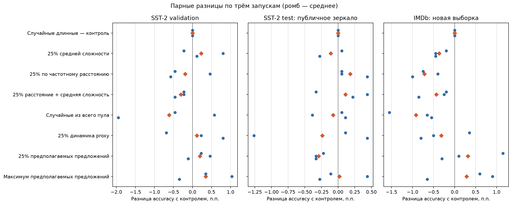

# Отбор 10% SST-2: статьи 2025–2026 и эксперименты

## Постановка

24 обучения ModernBERT-base, 8 вариантов × 3 связанных seed (17/42/101), одинаковая модель и гиперпараметры. Каждый вариант содержит 6534 строки — около 10% исходного пула 65 349, или 10.68% пула после очистки. Взвешивания нет. Макро-F1 и accuracy рассчитаны независимо по сохранённым предсказаниям. Epoch выбирается по внутренним 2000 строкам train; SST-2 validation (872 строки) ранее многократно использовался для исследования и здесь не является слепым тестом.

До построения proxy и отбора исключены 4150 строк, совпадающих по нормализованному тексту или имеющих общий восьмисловный фрагмент с внутренней val либо GLUE validation; осталось 61199. После очистки аудит обнаружил ноль таких пересечений. Более короткие или изменённые фрагменты могут остаться. Метки всего допустимого пула доступны proxy: бюджет 10% относится к финальному обучению, а не к разметке или proxy-обучению.

У `long_random`, `long_mid`, `long_fd`, `long_fd_mid`, `long_gsnr` и `long_roots_matched` внутри каждого seed одни и те же 4900 случайных длинных строк; 1634 оставшиеся имеют одинаковые квоты по метке и группам длины. `pool_random` и `long_roots_max` не имеют этого общего фона. `long_roots_max` включает все 5419 допустимых предполагаемых корней длиной ≥8 слов и случайные другие длинные фразы. Корни восстановлены по лексической вложенности, а не по исходным деревьям; больше подробностей в `PROTOCOL_ROOTS.md`.

## Качество и стоимость

Среднее ± выборочное стандартное отклонение по трём запускам. Δ — средняя разница accuracy к `long_random` на тех же seed, в процентных пунктах; у методов без общего фона она не является строго парной заменой части выборки. Число токенов — сумма токенов выбранных строк за эпоху после обрезки, без учёта дополнительного padding; это не количество FLOPs.

На открытом SST-2 test наиболее высокое среднее в этой серии показал частотный отбор: 94.42% против 94.23% у случайных длинных фраз. Разница с контролем по seed составила +0.05 / +0.05 / +0.44 п.п.; одновременно на GLUE validation средняя разница равна -0.19 п.п., а на IMDb -0.72 п.п. Малый эффект, три seed и множественные сравнения не подтверждают устойчивое превосходство.

Максимальная доля предполагаемых целых предложений дала 94.25% на открытом test против 94.23% у контроля. В этих условиях воспроизвести заметный выигрыш над длинными фразами не удалось; строгая очистка и доля целых предложений отличаются от опыта коллеги. Случайный отбор всего пула дал 94.16% на том же test, при меньшем количестве токенов за эпоху; из этого нельзя заключить статистическую эквивалентность методов.

| Метод | GLUE val accuracy ± SD, % | macro-F1, % | Δ val, п.п. | IMDb accuracy ± SD, % | macro-F1, % | Δ IMDb, п.п. | SST-2 test accuracy ± SD, % | macro-F1, % | Δ test, п.п. | Токенов / эпоха |
|---|---:|---:|---:|---:|---:|---:|---:|---:|---:|---:|
| Случайные длинные — контроль | 93.20 ± 0.58 | 93.19 | +0.00 | 81.08 ± 0.63 | 81.07 | +0.00 | 94.23 ± 0.05 | 94.23 | +0.00 | 143.3 тыс. |
| 25% средней сложности | 93.43 ± 0.52 | 93.42 | +0.23 | 80.72 ± 0.63 | 80.67 | -0.37 | 94.12 ± 0.22 | 94.12 | -0.11 | 143.3 тыс. |
| 25% по частотному расстоянию | 93.00 ± 0.30 | 93.00 | -0.19 | 80.37 ± 0.34 | 80.31 | -0.72 | 94.42 ± 0.18 | 94.42 | +0.18 | 142.9 тыс. |
| 25% расстояние + средняя сложность | 92.89 ± 0.46 | 92.89 | -0.31 | 80.65 ± 0.35 | 80.62 | -0.43 | 94.34 ± 0.36 | 94.34 | +0.11 | 143.1 тыс. |
| Случайные из всего пула | 92.58 ± 0.69 | 92.58 | -0.61 | 80.17 ± 0.92 | 80.12 | -0.92 | 94.16 ± 0.27 | 94.16 | -0.07 | 91.2 тыс. |
| 25% динамика proxy | 93.31 ± 1.15 | 93.31 | +0.11 | 80.77 ± 0.69 | 80.73 | -0.32 | 94.00 ± 0.89 | 93.99 | -0.24 | 143.5 тыс. |
| 25% предполагаемых предложений | 93.39 ± 0.29 | 93.38 | +0.19 | 81.40 ± 0.78 | 81.38 | +0.32 | 93.94 ± 0.11 | 93.94 | -0.29 | 143.8 тыс. |
| Максимум предполагаемых предложений | 93.54 ± 0.13 | 93.54 | +0.34 | 81.37 ± 0.25 | 81.34 | +0.28 | 94.25 ± 0.39 | 94.25 | +0.02 | 171.5 тыс. |

### Разница с контролем по каждому seed

Порядок seed: 17 / 42 / 101, процентные пункты. `pool_random` и `long_roots_max` не используют общий фон, поэтому их разница не является точечной заменой 25% примеров.

| Метод | GLUE validation | Открытый SST-2 test | IMDb |
|---|---|---|---|
| 25% средней сложности | -0.23 / +0.80 / +0.11 | +0.05 / -0.11 / -0.27 | -0.20 / -0.45 / -0.45 |
| 25% по частотному расстоянию | -0.46 / +0.46 / -0.57 | +0.05 / +0.05 / +0.44 | -0.75 / -0.40 / -1.00 |
| 25% расстояние + средняя сложность | -0.23 / -0.23 / -0.46 | -0.33 / +0.44 / +0.22 | -0.20 / -0.25 / -0.85 |
| Случайные из всего пула | -0.46 / +0.57 / -1.95 | +0.05 / -0.38 / +0.11 | -1.55 / -0.65 / -0.55 |
| 25% динамика proxy | -0.69 / +0.23 / +0.80 | +0.11 / -1.26 / +0.44 | +0.35 / -0.50 / -0.80 |
| 25% предполагаемых предложений | +0.23 / +0.46 / -0.11 | -0.22 / -0.33 / -0.33 | +1.15 / +0.10 / -0.30 |
| Максимум предполагаемых предложений | +0.34 / +1.03 / -0.34 | -0.11 / +0.44 / -0.27 | +0.60 / +0.90 / -0.65 |

### Срезы GLUE validation

Средняя accuracy в процентах по трём seed. Размеры срезов: <8 слов — 65, 8–15 — 246, 16+ — 561, отрицательные — 428, положительные — 444. Все срезы исследовательские, а GLUE validation многократно использовалась при разработке проекта.

| Метод | <8 слов | 8–15 слов | 16+ слов | Отрицательные | Положительные |
|---|---:|---:|---:|---:|---:|
| Случайные длинные — контроль | 89.23 | 92.68 | 93.88 | 92.99 | 93.39 |
| 25% средней сложности | 91.79 | 93.50 | 93.58 | 93.85 | 93.02 |
| 25% по частотному расстоянию | 91.79 | 92.55 | 93.35 | 93.46 | 92.57 |
| 25% расстояние + средняя сложность | 91.28 | 91.87 | 93.52 | 92.83 | 92.94 |
| Случайные из всего пула | 91.28 | 92.28 | 92.87 | 92.21 | 92.94 |
| 25% динамика proxy | 92.82 | 92.55 | 93.70 | 93.30 | 93.32 |
| 25% предполагаемых предложений | 89.23 | 92.82 | 94.12 | 92.21 | 94.52 |
| Максимум предполагаемых предложений | 91.28 | 92.68 | 94.18 | 92.76 | 94.29 |

Методы 2025/2026 — адаптации: `long_fd` вдохновлён [SCDP, COLING 2025](https://aclanthology.org/2025.coling-main.49/) и использует иные настройки TF-IDF, долю отбора и ограничения; `long_gsnr` вдохновлён [GRADFILTERING, EMNLP 2026](https://aclanthology.org/2026.emnlp-main.2297/), но применяет ансамбль линейных моделей, а не LoRA к генеративной модели. Результаты не являются воспроизведением этих работ.

## Состав подмножеств

Показаны средние по seed характеристики, рассчитанные до оценки качества. Число источников и пересечение с внутренней val учитывают только фразы, для которых лексическая эвристика нашла ровно одного возможного родителя; это не восстановленные исходные деревья SST. Несмотря на удаление общих 8-граммов, обнаруженные совпадения предполагаемых родителей показывают риск утечки через короткие фрагменты при выборе эпохи.

| Метод | Предполагаемых целых предложений, % | Разных однозначно сопоставленных источников | Строк с предполагаемым родителем из внутренней val |
|---|---:|---:|---:|
| Случайные длинные — контроль | 20.5 | 3652 | 1064 |
| 25% средней сложности | 19.9 | 3579 | 1066 |
| 25% по частотному расстоянию | 20.7 | 3601 | 1052 |
| 25% расстояние + средняя сложность | 20.3 | 3571 | 1049 |
| Случайные из всего пула | 9.9 | 3832 | 1319 |
| 25% динамика proxy | 20.7 | 3561 | 1048 |
| 25% предполагаемых предложений | 40.4 | 4195 | 979 |
| Максимум предполагаемых предложений | 82.9 | 5452 | 920 |

Вероятность исходной метки и доля несовпадений ответа OOF proxy с меткой позволяют увидеть, какие данные реально попали в выборку. Несовпадение не является подтверждённой ошибкой разметки. Для всех методов с общим фоном измерены 1634 добавленные позиции; для `pool_random` и `long_roots_max` — всё подмножество, поэтому строки этих двух методов не вполне сопоставимы с остальными.

| Метод | Область расчёта | P(исходная метка) | Несогласие proxy, % |
|---|---|---:|---:|
| Случайные длинные — контроль | 1634 добавленные строки | 0.807 | 7.2 |
| 25% средней сложности | 1634 добавленные строки | 0.866 | 0.0 |
| 25% по частотному расстоянию | 1634 добавленные строки | 0.806 | 7.6 |
| 25% расстояние + средняя сложность | 1634 добавленные строки | 0.877 | 0.0 |
| Случайные из всего пула | Вся выборка | 0.789 | 9.3 |
| 25% динамика proxy | 1634 добавленные строки | 0.818 | 1.6 |
| 25% предполагаемых предложений | 1634 добавленные строки | 0.794 | 9.6 |
| Максимум предполагаемых предложений | Вся выборка | 0.800 | 9.0 |

### Исследовательская связь с качеством

Ниже — корреляция Спирмена между характеристиками и средней accuracy на открытом SST-2 test на уровне восьми стратегий. Подмножества сильно пересекаются, характеристики зависят друг от друга, а сравниваемых методов мало; коэффициенты описывают лишь эту серию и не доказывают причину или перенос на другие задачи.

| Характеристика | Спирмен ρ |
|---|---:|
| Средняя длина, слова | -0.19 |
| Доля позитивных меток | +0.09 |
| Доля предполагаемых целых предложений | -0.10 |
| Разные предполагаемые источники | -0.02 |

## Перенос и ограничения

Исходный SST-2 test: 1821 размеченное предложение из открытого [зеркала](https://github.com/AcademiaSinicaNLPLab/sentiment_dataset/blob/master/data/stsa.binary.test), не официальная отправка на GLUE leaderboard. Из них 1814 после нормализации текстов совпадают с неразмеченным GLUE test; у семи различается запись. Открытый dev этого источника совпал по тексту и метке со всеми 872 примерами GLUE validation. Длину в 64 токена превышает 1 предложение теста. Варианты отбирались после изучения предыдущих экспериментов на validation; публичный test и возможное использование тех же данных на pretraining ограничивают независимость этой проверки.

Ниже — accuracy на всех 1821 примере и на 1818 примерах без точного совпадения или общего восьмисловного фрагмента с допустимым пулом. Для каждого метода показано среднее по трём seed.

| Метод | Все 1821, % | После исключения пересечений, % |
|---|---:|---:|
| Случайные длинные — контроль | 94.23 | 94.26 |
| 25% средней сложности | 94.12 | 94.17 |
| 25% по частотному расстоянию | 94.42 | 94.46 |
| 25% расстояние + средняя сложность | 94.34 | 94.39 |
| Случайные из всего пула | 94.16 | 94.19 |
| 25% динамика proxy | 94.00 | 94.04 |
| 25% предполагаемых предложений | 93.94 | 93.99 |
| Максимум предполагаемых предложений | 94.25 | 94.30 |

IMDb: новая фиксированная выборка 2000 отзывов, отдельная от 2000 IMDb-примеров серии 05, по 1000 каждого класса. Точных нормализованных совпадений с SST-2: 0; отзывов с общим 8-граммом: 3. Обрезаны до 64 токенов 1952 из 2000 отзывов. IMDb — иной домен, а пересечение с данными предварительного обучения неизвестно. Это проверка переноса, не новый слепой SST-2 тест.

Выборки и инициализации связаны seed; три повтора не разделяют вариативность выбора данных и обучения. Сравниваются несколько стратегий без поправки на множественные проверки. Уверенные выводы о малых разницах и превосходстве над коллегами без новых независимых повторов и оценки невозможны. Время CPU-просчёта proxy и время GPU-обучения сохранены раздельно, а часть моделей обучалась параллельно; `long_fd` seed 101 был продолжен с полного чекпоинта после первой эпохи. Wall time не является честным сравнением FLOPs или ускорения. Равное число примеров не означает равную стоимость по токенам.

Разбор статей — `experiments/07_literature_strict/LITERATURE.md`; результаты коллеги — `COLLABORATOR.md`; протоколы, манифесты, хэши, прогнозы и исходные метрики сохранены в ветке проекта.
