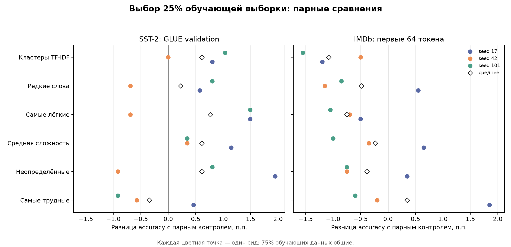

# Исследование отбора обучающих примеров для ModernBERT

**Завершено: 21 новое обучение и 27 оценок на IMDb.** Результаты исследовательские: по три связанных сида, несколько сравнений.

## Постановка и дизайн

Модель — `answerdotai/ModernBERT-base`, SST-2 pool — 65 349 строк; каждое обучение использует 6534 строки (10%).
Все новые варианты отбирают длинные фразы: 4900 строк — общий случайный фон, 1634 места меняются методом.
Внутри одного сида для всех вариантов совпадают количество меток и распределение по группам длины.
Лучший checkpoint выбирается по внутренней валидации из 2000 строк; основная оценка — 872 строки GLUE validation.
Метки всего пула используются для обучения TF-IDF proxy и отбора; это не эксперимент с бюджетом разметки 10%.
Seeds 17/42/101 одновременно задают proxy, выборку и обучение target. Методические детали и протокол — в `experiments/05_proxy_mixture/README.md`.

## Результаты

Среднее ± выборочное стандартное отклонение по трём запускам; Δ — средняя парная разница accuracy
с `mix_random` того же сида в процентных пунктах. У двух baseline из прошлой серии общий фон не фиксирован, поэтому Δ не приводится.

| Метод | SST-2 accuracy ± SD | Macro F1 | Δ, п.п. | IMDb accuracy ± SD | Macro F1 | Δ, п.п. |
|---|---:|---:|---:|---:|---:|---:|
| Random всего пула | 92.85% ± 0.29 п.п. | 92.84% | — | 81.30% ± 0.33 п.п. | 81.29% | — |
| Random среди длинных | 93.65% ± 0.75 п.п. | 93.65% | — | 81.22% ± 0.42 п.п. | 81.21% | — |
| Парный random-контроль | 92.58% ± 0.26 п.п. | 92.58% | 0,00 | 81.95% ± 0.66 п.п. | 81.94% | 0,00 |
| 25% самых трудных | 92.24% ± 0.69 п.п. | 92.23% | -0.34 | 82.30% ± 0.65 п.п. | 82.29% | +0.35 |
| 25% неопределённых | 93.20% ± 1.20 п.п. | 93.19% | +0.61 | 81.57% ± 0.13 п.п. | 81.56% | -0.38 |
| 25% средней сложности | 93.20% ± 0.40 п.п. | 93.19% | +0.61 | 81.72% ± 0.23 п.п. | 81.71% | -0.23 |
| 25% самых лёгких | 93.35% ± 0.99 п.п. | 93.35% | +0.76 | 81.20% ± 0.44 п.п. | 81.20% | -0.75 |
| 25% редких слов | 92.81% ± 0.54 п.п. | 92.81% | +0.23 | 81.47% ± 0.37 п.п. | 81.39% | -0.48 |
| 25% по кластерам TF-IDF | 93.20% ± 0.29 п.п. | 93.19% | +0.61 | 80.87% ± 0.85 п.п. | 80.86% | -1.08 |

### Разница с парным контролем по сидам

| Метод | SST-2 seed 17 / 42 / 101, п.п. | IMDb seed 17 / 42 / 101, п.п. |
|---|---|---|
| 25% самых трудных | +0.46 / -0.57 / -0.92 | +1.85 / -0.20 / -0.60 |
| 25% неопределённых | +1.95 / -0.92 / +0.80 | +0.35 / -0.75 / -0.75 |
| 25% средней сложности | +1.15 / +0.34 / +0.34 | +0.65 / -0.35 / -1.00 |
| 25% самых лёгких | +1.49 / -0.69 / +1.49 | -0.50 / -0.70 / -1.05 |
| 25% редких слов | +0.57 / -0.69 / +0.80 | +0.55 / -1.15 / -0.85 |
| 25% по кластерам TF-IDF | +0.80 / +0.00 / +1.03 | -1.20 / -0.50 / -1.55 |

## Что видно в данных

- Среди новых вариантов на использованной в проекте SST-2-оценке наибольшую среднюю accuracy получил `mix_easy` (93.35%); это результат поиска среди нескольких методов, а не подтверждение превосходства.
- Простой случайный отбор длинных фраз из серии 04 дал 93.65% на SST-2; это выше среднего лучшего нового варианта. Выборки другие, поэтому это не парная оценка эффекта конкретного критерия.
- Отбор средней по группе уверенности показал положительную разницу с контролем на 3 из 3 сидов SST-2 и на 1 из 3 сидов IMDb. Этого недостаточно, чтобы утверждать перенос эффекта.
- Кластерный отбор на IMDb показал отрицательную разницу с контролем на 3 из 3 сидов; это наблюдение на длинных обрезанных отзывах, а не универсальный вывод о разнообразии.
- Главный контроль — `mix_random`: он имеет тот же фон и те же квоты класса и длины, что и специальные варианты.
- В таблице исходные `random` и `len8` взяты из серии 04, обученной с теми же моделью, сплитами и окружением; это полезные, но не идентично подобранные контроли.

### Что реально выбрали методы

В таблице — средняя длина всей выборки и характеристики добавленных 1634 целевых строк, усреднённые по трём сидам.
Ошибка proxy — несовпадение его OOF-ответа с существующей меткой, а не подтверждённая ошибка разметки.

| Метод | Средняя длина, слов | Proxy не согласен с меткой | Средняя вероятность метки | Затронуто кластеров |
|---|---:|---:|---:|---:|
| Парный random-контроль | 16.12 | 8.1% | 0.805 | 40.0 из 64 |
| 25% самых трудных | 16.12 | 96.8% | 0.316 | 31.7 из 64 |
| 25% неопределённых | 16.11 | 40.9% | 0.512 | 32.0 из 64 |
| 25% средней сложности | 16.11 | 0.0% | 0.863 | 39.3 из 64 |
| 25% самых лёгких | 16.12 | 0.0% | 0.977 | 34.0 из 64 |
| 25% редких слов | 16.07 | 10.6% | 0.779 | 27.0 из 64 |
| 25% по кластерам TF-IDF | 16.13 | 8.2% | 0.801 | 64.0 из 64 |

Наибольший TF-IDF-кластер содержит 49.2% всех допустимых длинных строк; равномерный отбор по кластерам меняет исходное распределение.

## Внешняя оценка и совпадения

IMDb: 2000 отзывов, по 1000 каждого класса, случайная фиксированная выборка test split;
0 точных совпадений со строками SST-2 после нормализации,
7 отзывов содержат общий фрагмент из восьми токенов.
1958 из 2000 отзывов длиннее максимума в 64 токена. IMDb оценивает перенос на иной тип длинных отзывов;
эти метрики нельзя считать прямой оценкой на новых SST-2 предложениях. Совпадения с данными предварительного обучения модели не проверены.
Rotten Tomatoes исключён как независимый тест: 706 из 1066 строк совпадают с SST-2 после нормализации.

## Ограничения

- Лишь три сида, с привязанными друг к другу seed proxy, отбора и обучения. Малые разницы ненадёжны.
- Шесть новых критериев сравниваются с контролем; поправка на множественные проверки не проведена.
- GLUE validation уже многократно использовался в проекте; выбор лучшего метода по нему оптимистичен.
- 24 текста внутренней валидации ранее обнаружены в пуле; родство фрагментов исходных предложений проверено не полностью.
- Скор ошибки proxy не доказывает ошибку разметки; требуется независимая человеческая проверка.
- Время обучения не является сравнением ускорения: два процесса делили GPU; метки и затраты proxy учтены отдельно.

## Статьи

- [Dataset Cartography](https://arxiv.org/abs/2009.10795): динамика уверенности и разновидности трудности; наш OOF TF-IDF — иной proxy.
- [Selection via Proxy](https://arxiv.org/abs/1906.11829): возможность использовать недорогую модель для отбора.
- [Coverage-centric Coreset Selection](https://arxiv.org/abs/2210.15809): значимость покрытия при сильном сокращении данных; кластеризация здесь не CCS.
- [Beyond Neural Scaling Laws](https://arxiv.org/abs/2206.14486): зависимость пользы критериев от режима и размера набора; основные эксперименты статьи — на изображениях.
- [Disentangling the Roles of Representation and Selection in Data Pruning](https://aclanthology.org/2025.acl-long.821/): роль представления и алгоритма отбора.

Код, индексы, хэши, аудиты, скоры и предсказания находятся в ветке `AmirBikineev`: `experiments/05_proxy_mixture/` и `results/proxy_mixture/`.
