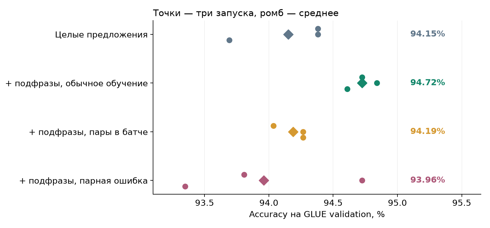
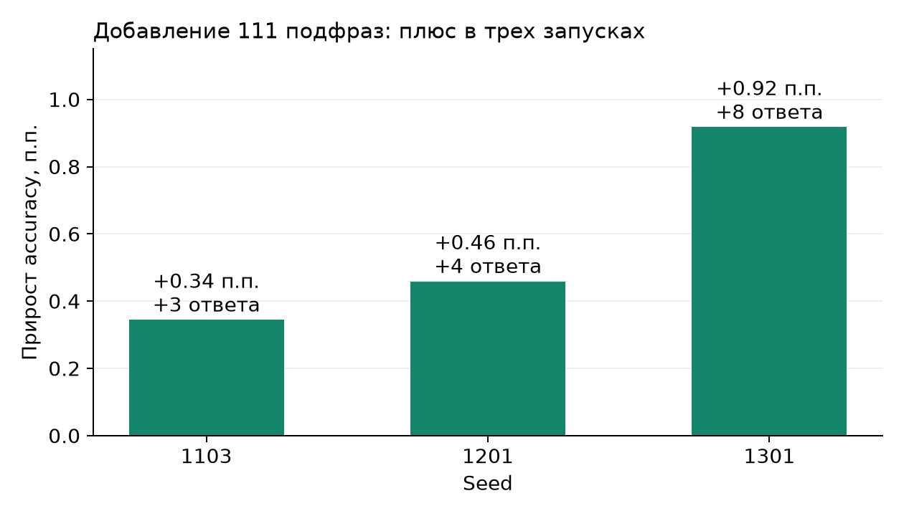
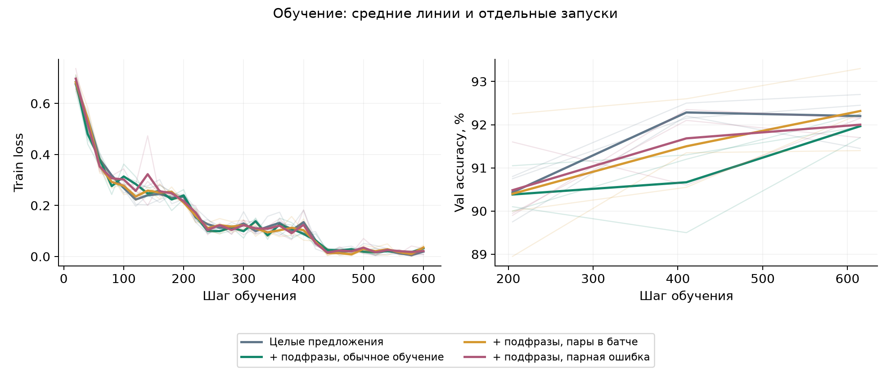

# Целые предложения и 111 контрастных подфраз

**Лучший результат: 94.72% accuracy и 94.72% macro-F1 на 10% SST-2. Контроль из целых предложений — 94.15%; прирост +0.57 п.п.** Во всех трех запусках добавление подфраз улучшило качество. Это самое высокое среднее в завершенных сериях моей ветки.

## Откуда появилась идея

Я взяла за основу результат Амира: целые предложения SST-2 дали 94.62% против 92.67% при случайном отборе; full — 95.57%. Катя продолжила эту идею, добавив 131 подфразу с противоположной меткой: на двух завершенных сравнениях получилось +0.34 п.п. к ее контролю.

Я проверила следующий вопрос: поможет ли явно обучать модель связи между целым предложением и его частью? Для этого сравнила обычное обучение, совместное предъявление пары и дополнительную ошибку за неверный порядок вероятностей.

- [Результат Амира](https://github.com/Angmtlln/Data-Efficient-Training-Knowledge-Distillation/blob/Amir_N_experiments/REPORT.md).
- [Эксперименты Кати](https://github.com/Angmtlln/Data-Efficient-Training-Knowledge-Distillation/blob/katyaSVP/SVP_RESULTS.md).
- [Socher et al., 2013](https://aclanthology.org/D13-1170/): исходный SST содержит деревья предложений и метки их частей. Я использовала эту структуру для поиска пар. Парную ошибку предложила как отдельное продолжение эксперимента.

## Как я нашла пары

Взяла исходные train-деревья SST из зеркала `stanfordnlp/sst`. Сопоставила узлы с существующими строками pool по нормализованному тексту и метке. Нашла 6658 допустимых целых предложений.

Для каждой пары целое предложение и его подфраза имеют противоположные метки. Подфраза содержит минимум восемь слов и половину слов родителя. В добавленном контексте есть маркер отрицания или противопоставления. Оба текста полностью помещаются в 64 токена ModernBERT. Совпадения с текстами val/test исключены из кандидатов.

Отбросила случаи, где различие сводится к пунктуации, и очевидные обрывы на союзах. Автоматические правила оставили 166 непересекающихся пар; после текстовой проверки с помощью ассистента оставила 111. Решения сохранены в [pair_review.json](../../experiments/06_root_pair_training/pair_review.json). Это один просмотр; независимой человеческой проверки меток не было. Исходные метки сохранила.

Пример из выбранных пар:

| Текст | Метка |
|---|---|
| “ash wednesday is not edward burns' best film, but it is a good and ambitious film.” | Положительная |
| “ash wednesday is not edward burns' best film” | Отрицательная |

Для поиска использовала деревья и текстовые правила. Отдельную модель отбора не обучала.

## Какие условия сравнила

Во всех случаях дообучала `answerdotai/ModernBERT-base` на 6534 разных строках. Для смеси оставила 6423 целых предложения и добавила 111 подфраз — 1.70% набора. Родители этих подфраз остались в обучении. Каждой добавке сопоставила удаляемое предложение того же класса с ближайшей доступной длиной.

| Вариант | Тексты | Как обучала |
|---|---|---|
| Целые предложения | 6534 целых предложения | Обычная классификация |
| Добавлены подфразы | 6423 предложения + 111 подфраз | Случайные батчи |
| Пары в одном батче | Та же смесь | Родитель и подфраза попадают в один батч |
| Парная ошибка | Та же смесь и те же батчи | Дополнительно требовала более высокую вероятность положительного класса у положительного участника |

Между тремя вариантами смеси тексты совпадают. Между последними двумя совпадают также батчи. Все 111 пар одинаковы для трех seed; меняются остальной состав, порядок батчей и обучение. Разбиение на батчи фиксировано внутри запуска, между эпохами меняется порядок батчей.

Обучение: три эпохи, 615 шагов, 32 текста в батче, lr=5e-5, warmup=6%, weight decay=.01, максимум 64 токена. Seeds: 1103, 1201, 1301. GPU — RTX 5090, torch 2.14.1+cu132. Лучшую эпоху выбирала по accuracy на 2000 строках внутренней val. Итоговая оценка — 872 строки GLUE validation.

Для парной ошибки зафиксировала коэффициент 0.2 и отступ вероятности 0.2. Если разница вероятностей меньше отступа, добавляется штраф. Формула и полный протокол — [PROTOCOL.md](../../experiments/06_root_pair_training/PROTOCOL.md).

## Результаты

Среднее трех запусков. SD — стандартное отклонение между запусками.

| Вариант | Accuracy, % | SD, п.п. | Macro-F1, % | К целым предложениям, п.п. |
|---|---:|---:|---:|---:|
| Целые предложения | 94.15 | 0.40 | 94.15 | — |
| **Добавлены подфразы, обычное обучение** | **94.72** | **0.11** | **94.72** | **+0.57** |
| Пары в одном батче | 94.19 | 0.13 | 94.19 | +0.04 |
| Парная ошибка | 93.96 | 0.70 | 93.96 | −0.19 |



| Seed | Целые предложения | Добавлены подфразы | Разница, п.п. | Дополнительные верные ответы |
|---|---:|---:|---:|---:|
| 1103 | 94.38% | 94.72% | +0.34 | +3 |
| 1201 | 94.38% | 94.84% | +0.46 | +4 |
| 1301 | 93.69% | 94.61% | +0.92 | +8 |



Добавление подфраз дало плюс во всех трех запусках. Совместное предъявление тех же текстов снизило среднюю accuracy на 0.54 п.п. относительно обычного обучения. Дополнительная парная ошибка снизила ее еще на 0.23 п.п. относительно тех же батчей без штрафа. Последнее сравнение и было основной проверкой гипотезы.

## Что происходило при обучении



На графике слева показана общая ошибка обучения: у варианта с парным штрафом она включает этот штраф. Справа — accuracy на внутренней val; тонкие линии соответствуют отдельным seed.

Внутренняя val выбрала третью эпоху для всех запусков обычной смеси и варианта с парами в батче. Для парной ошибки в двух из трех случаев выбрала вторую эпоху. У контроля в одном случае также выбрала вторую. Значения каждой эпохи сохранены в [epochs.csv](epochs.csv).

По мере обучения val loss растет, хотя val accuracy часто улучшается. Это совместимо с ростом уверенности в оставшихся ошибках. График сам по себе не устанавливает причину разницы между методами.

## Где появился прирост

Я дополнительно проверила группы по наличию слов-маркеров. Они выделены автоматически и могут пересекаться.

| Группа | Строк | Целые предложения, % | Обычная смесь, % | Разница, п.п. |
|---|---:|---:|---:|---:|
| Все примеры | 872 | 94.15 | 94.72 | +0.57 |
| Маркеры отрицания | 168 | 93.45 | 94.25 | +0.79 |
| Маркеры противопоставления | 141 | 95.27 | 95.04 | −0.24 |

На отрицаниях есть небольшой плюс, на противопоставлениях его нет. Поэтому по этим данным я могу говорить об улучшении общей accuracy, но обучение пониманию конкретной конструкции еще требует отдельной проверки. Правила групп заданы в [скрипте анализа](../../scripts/root_pairs_report.py); они шире правил старых серий.

## Выводы

Я получила хороший предварительный результат: **94.72% на 10% строк**, с приростом **+0.57 п.п. к сильному собственному контролю**. Выигрыш получился при замене 111 строк и обычном обучении. Это основание повторить смесь на новых seed.

Гипотеза о пользе дополнительной парной ошибки в выбранной настройке не подтвердилась. Совместное предъявление пары также не улучшило результат по сравнению с обычной смесью. Причину снижения качества этот опыт не устанавливает.

Отбор подфраз частично повторяет направление Кати; мой дополнительный вклад — сравнение трех способов обучения на одинаковой смеси. По сравнению с 94.62% из отчета Амира получено численно большее среднее, но для вывода о превосходстве нужно сравнение в одном окружении на одних seed. У Амира десять повторов, здесь три.

GLUE validation уже многократно использовался в проекте. Сохранилось унаследованное разбиение внутренней val на уровне фраз: связанные фрагменты одного предложения могут попасть в разные части. Бюджет 10% относится к финальному обучению; при подготовке доступны метки pool и структура деревьев. Это ограничивает перенос выводов на задачи с дорогой разметкой.

## Воспроизведение и артефакты

- [Код и запуск](../../experiments/06_root_pair_training/README.md), [зафиксированный протокол](../../experiments/06_root_pair_training/PROTOCOL.md).
- [Метрики каждого запуска](runs.csv), [средние](summary.csv), [парные разницы и изменения ответов](comparisons.csv), [срезы](slices.csv).
- В `runs/` сохранены исходные метрики, предсказания, конфигурации, составы выборок, история и версии библиотек. В `pilots/` находятся отдельные технические прогоны.
- Веса всех 12 моделей сохранены локально в `HW-project/vm_runs/enn_root_pairs_20261126/outputs/runs/`. Большие файлы весов не входят в Git.

Пересчет таблиц и трех графиков из сохраненных предсказаний:

```bash
python scripts/root_pairs_report.py
```

Для дополнительных срезов нужна восстановленная папка данных новой серии. Основные таблицы и графики строятся из архива. При пересчете проверяются число шагов, размеры наборов, метрики и совпадение трех смесей.
