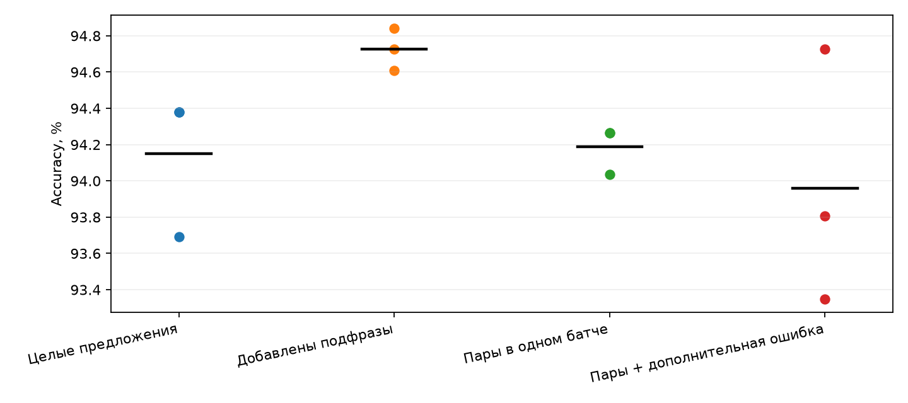
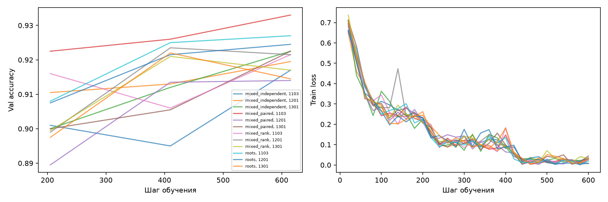

# Связь целого предложения и подфразы

Завершено 12 из 12 основных запусков.

| Метод | Запусков | Accuracy, % | SD, п.п. | Macro-F1, % |
|---|---:|---:|---:|---:|
| Целые предложения | 3 | 94.15 | 0.40 | 94.15 |
| Добавлены подфразы | 3 | 94.72 | 0.11 | 94.72 |
| Пары в одном батче | 3 | 94.19 | 0.13 | 94.19 |
| Пары + дополнительная ошибка | 3 | 93.96 | 0.70 | 93.96 |

Главное сравнение: mixed_rank против mixed_paired на одинаковых текстах и батчах. Разницы по каждому seed сохранены в comparisons.csv. Итоговая оценка использует многократно исследованный GLUE validation; небольшие различия требуют независимого подтверждения.